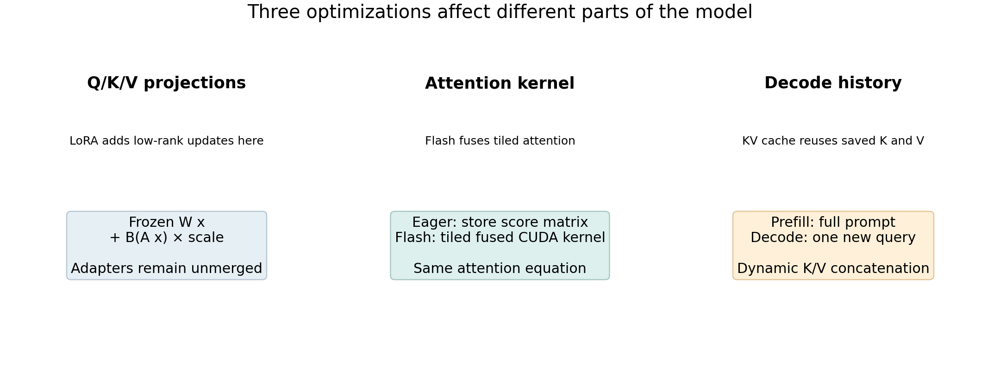
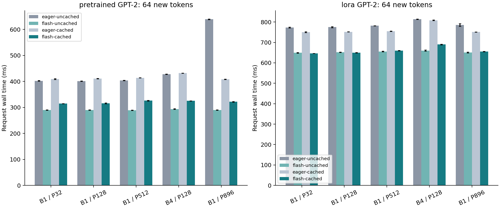
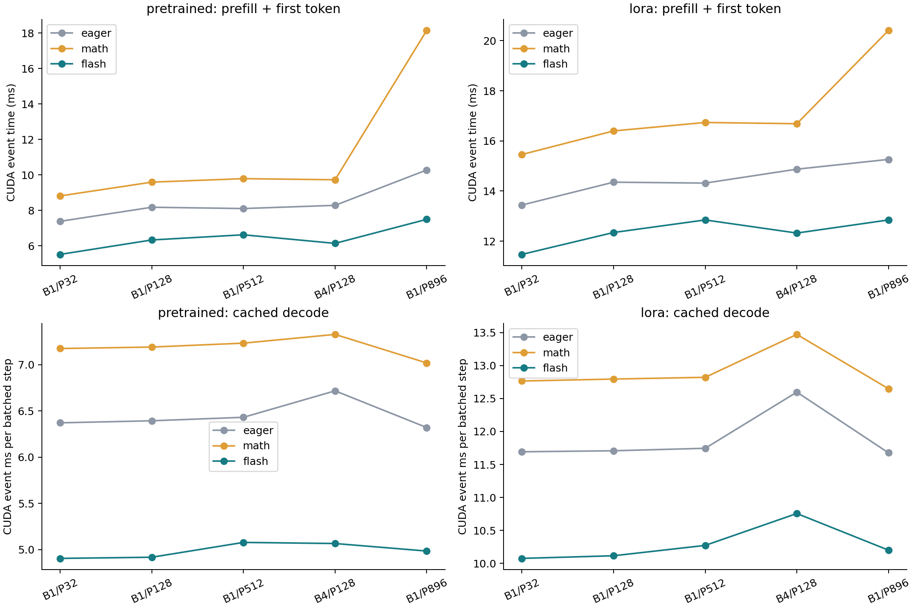
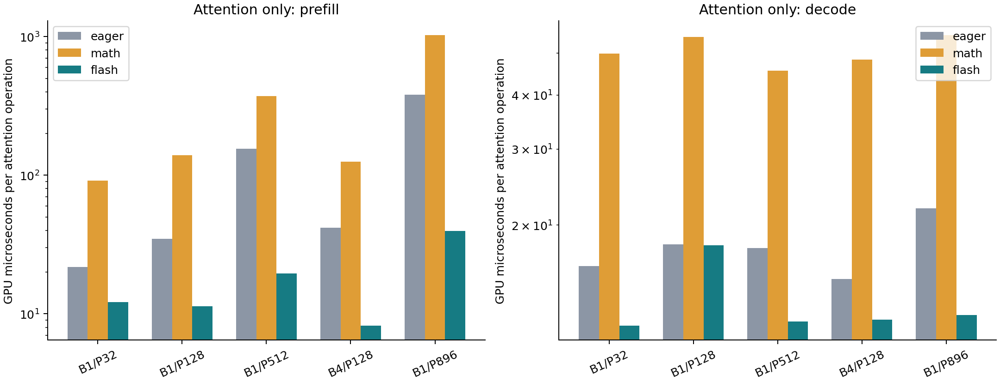
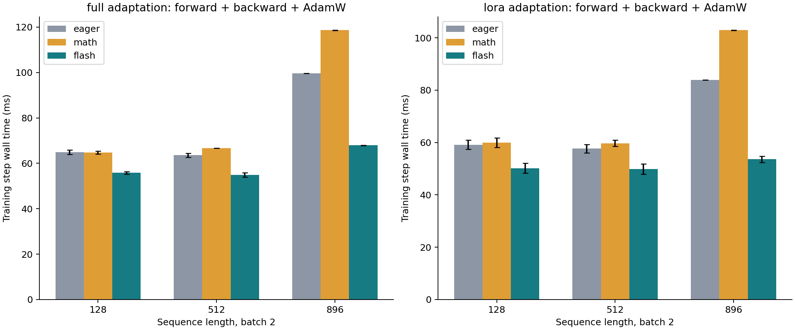
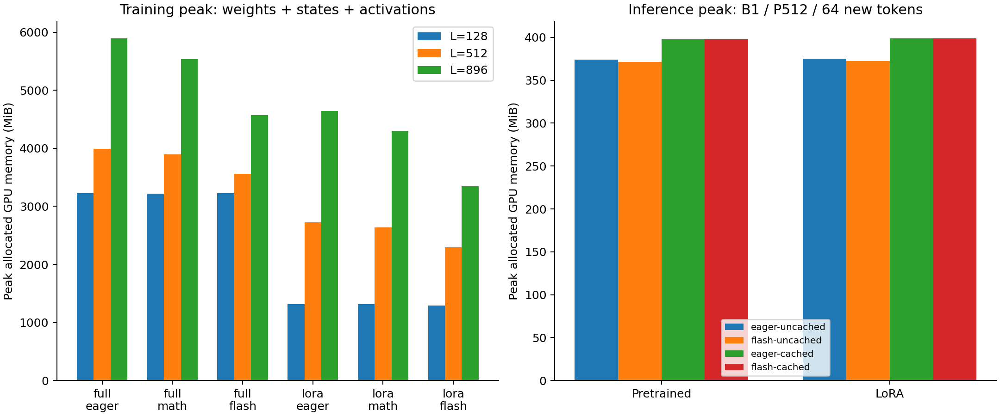

## FlashAttention in minGPT: measured results

**What was run**

NVIDIA A30; PyTorch 2.14.0+cu130; CUDA 13.0; TF32 off. Job 2391887 on gpu-4-21.int.turing.wpi.edu; run started 2026-10-19T17:37:28Z. GPT-2: 12 layers, width 768, 12 heads, vocabulary 50,257, context 1,024. Inference uses BF16 weights/activations for EVERY backend. Training uses FP32 master weights, BF16 autocast and AdamW. 3 warmups and 7 measured repetitions per case.

**Measured highlights**

At batch 1 / prompt 512 / 64 generated tokens, forced FlashAttention changes pretrained uncached generation from 403.9 to 289.5 ms (1.40x). Flash plus cache takes 326.4 ms (1.24x versus eager without cache).
For the trained unmerged LoRA model, the corresponding flash-only and combined speedups are 1.19x and 1.18x.
At training batch 2 / length 512, FlashAttention speeds up full updates by 1.16x and LoRA updates by 1.16x. LoRA + flash versus full eager changes step latency by 1.28x and lowers peak allocation by 42.5%. These are execution measurements, not time-to-quality results.

**Controls**

Within each checkpoint, weights, prompts, token counts, precision, output-head handling and cache implementation are held fixed. Eager is the original explicit attention; math forces SDPA math; flash forces SDPA FlashAttention with no fallback. Inference backend/cache order is shuffled with fixed seeds each repetition. LoRA adapters remain unmerged.

**Scope**

Speed measurements use deterministic random-token prompts and real pretrained/trained checkpoints. Task quality uses the existing 120 held-out sports questions on pretrained, full-finetuned and LoRA seed-42 checkpoints. Full fine-tuning shares pretrained inference architecture, so its timing is not repeated. All inference weight hashes matched before and after.

## Pretrained: generation and cache interaction

**Median request time, milliseconds**

| Batch/prompt | Eager off | Flash off | Eager on | Flash on | Combined |
| --- | --- | --- | --- | --- | --- |
| 1 / 32 | 402.5 | 290.1 | 408.9 | 314.6 | 1.28x |
| 1 / 128 | 401.3 | 290.2 | 411.0 | 316.2 | 1.27x |
| 1 / 512 | 403.9 | 289.5 | 413.7 | 326.4 | 1.24x |
| 4 / 128 | 427.6 | 293.8 | 431.9 | 325.4 | 1.31x |
| 1 / 896 | 639.2 | 290.4 | 408.5 | 321.8 | 1.99x |

**All kernels: median request time and cache gain**

| B/P | Backend | Off ms | On ms | On tok/s | Cache gain |
| --- | --- | --- | --- | --- | --- |
| 1/32 | eager | 402.5 | 408.9 | 156.5 | 0.98x |
| 1/32 | math | 490.9 | 460.9 | 138.9 | 1.07x |
| 1/32 | flash | 290.1 | 314.6 | 203.4 | 0.92x |
| 1/128 | eager | 401.3 | 411.0 | 155.7 | 0.98x |
| 1/128 | math | 488.6 | 462.7 | 138.3 | 1.06x |
| 1/128 | flash | 290.2 | 316.2 | 202.4 | 0.92x |
| 1/512 | eager | 403.9 | 413.7 | 154.7 | 0.98x |
| 1/512 | math | 583.3 | 465.6 | 137.5 | 1.25x |
| 1/512 | flash | 289.5 | 326.4 | 196.1 | 0.89x |
| 4/128 | eager | 427.6 | 431.9 | 592.7 | 0.99x |
| 4/128 | math | 508.5 | 471.4 | 543.1 | 1.08x |
| 4/128 | flash | 293.8 | 325.4 | 786.7 | 0.90x |
| 1/896 | eager | 639.2 | 408.5 | 156.7 | 1.56x |
| 1/896 | math | 1136.0 | 460.4 | 139.0 | 2.47x |
| 1/896 | flash | 290.4 | 321.8 | 198.9 | 0.90x |

**Read the comparisons**

Off/on means KV cache disabled/enabled. Combined divides eager-uncached by flash-cached; cache gain compares off/on at one fixed backend. Token throughput counts all generated tokens across the batch. Request time includes prefill, greedy token selection, output concatenation and all 64 generation steps; excludes model loading, tokenization, input transfer, warmup and cleanup.

## Lora: generation and cache interaction

**Median request time, milliseconds**

| Batch/prompt | Eager off | Flash off | Eager on | Flash on | Combined |
| --- | --- | --- | --- | --- | --- |
| 1 / 32 | 773.2 | 649.2 | 750.1 | 646.3 | 1.20x |
| 1 / 128 | 775.1 | 651.8 | 752.0 | 649.6 | 1.19x |
| 1 / 512 | 781.6 | 655.8 | 754.8 | 659.9 | 1.18x |
| 4 / 128 | 814.3 | 660.4 | 808.6 | 690.0 | 1.18x |
| 1 / 896 | 785.2 | 651.1 | 751.1 | 655.6 | 1.20x |

**All kernels: median request time and cache gain**

| B/P | Backend | Off ms | On ms | On tok/s | Cache gain |
| --- | --- | --- | --- | --- | --- |
| 1/32 | eager | 773.2 | 750.1 | 85.3 | 1.03x |
| 1/32 | math | 899.1 | 819.8 | 78.1 | 1.10x |
| 1/32 | flash | 649.2 | 646.3 | 99.0 | 1.00x |
| 1/128 | eager | 775.1 | 752.0 | 85.1 | 1.03x |
| 1/128 | math | 897.5 | 822.6 | 77.8 | 1.09x |
| 1/128 | flash | 651.8 | 649.6 | 98.5 | 1.00x |
| 1/512 | eager | 781.6 | 754.8 | 84.8 | 1.04x |
| 1/512 | math | 906.9 | 824.4 | 77.6 | 1.10x |
| 1/512 | flash | 655.8 | 659.9 | 97.0 | 0.99x |
| 4/128 | eager | 814.3 | 808.6 | 316.6 | 1.01x |
| 4/128 | math | 931.1 | 865.8 | 295.7 | 1.08x |
| 4/128 | flash | 660.4 | 690.0 | 371.0 | 0.96x |
| 1/896 | eager | 785.2 | 751.1 | 85.2 | 1.05x |
| 1/896 | math | 1261.6 | 817.4 | 78.3 | 1.54x |
| 1/896 | flash | 651.1 | 655.6 | 97.6 | 0.99x |

**Read the comparisons**

Off/on means KV cache disabled/enabled. Combined divides eager-uncached by flash-cached; cache gain compares off/on at one fixed backend. Token throughput counts all generated tokens across the batch. Request time includes prefill, greedy token selection, output concatenation and all 64 generation steps; excludes model loading, tokenization, input transfer, warmup and cleanup.

## Attention-only GPU latency

**Median microseconds per attention operation**

| B/P | Phase | Eager us | Math us | Flash us | FA gain |
| --- | --- | --- | --- | --- | --- |
| 1/32 | prefill | 21.71 | 91.60 | 12.13 | 1.79x |
| 1/32 | decode | 16.08 | 49.87 | 11.72 | 1.37x |
| 1/128 | prefill | 34.82 | 139.72 | 11.37 | 3.06x |
| 1/128 | decode | 18.07 | 54.48 | 17.97 | 1.01x |
| 1/512 | prefill | 155.60 | 371.76 | 19.56 | 7.96x |
| 1/512 | decode | 17.72 | 45.52 | 11.98 | 1.48x |
| 4/128 | prefill | 41.83 | 124.98 | 8.24 | 5.07x |
| 4/128 | decode | 15.00 | 48.28 | 12.08 | 1.24x |
| 1/896 | prefill | 381.44 | 1025.79 | 39.53 | 9.65x |
| 1/896 | decode | 21.86 | 55.04 | 12.39 | 1.76x |

**What is isolated**

A separate NVIDIA A30 allocation, job 2391890 on gpu-4-21.int.turing.wpi.edu. Synthetic BF16 Q/K/V, 12 heads, head dimension 64, contiguous head-major layout. Prefill uses square causal attention; decode uses one query and prompt+63 cached keys. Projections, LoRA branches, cache concatenation, norms, MLP, logits and sampling are excluded.

**Timing method**

Capture 20 attention operations in one CUDA graph; warm up five replays, measure 15 replays with CUDA events, divide by 20. Graph replay reduces per-operation Python dispatch; this is a diagnostic benchmark and is not enabled in minGPT generation. Timings include the captured attention operation and graph scheduling, not a single individual CUDA kernel. Eager/math are also graphed. Do not substitute these ratios for end-to-end model speedups.

## Training: cost, memory and parameter counts

**All measured training configurations**

| Method | Length | Backend | Step ms | Peak MiB | FA gain* |
| --- | --- | --- | --- | --- | --- |
| full | 128 | eager | 65.0 | 3224 | 1.00x |
| full | 128 | math | 64.8 | 3222 | 1.00x |
| full | 128 | flash | 55.8 | 3223 | 1.16x |
| full | 512 | eager | 63.6 | 3995 | 1.00x |
| full | 512 | math | 66.7 | 3894 | 0.95x |
| full | 512 | flash | 54.9 | 3562 | 1.16x |
| full | 896 | eager | 99.6 | 5898 | 1.00x |
| full | 896 | math | 118.6 | 5533 | 0.84x |
| full | 896 | flash | 67.9 | 4569 | 1.47x |
| lora | 128 | eager | 59.1 | 1312 | 1.00x |
| lora | 128 | math | 60.0 | 1315 | 0.99x |
| lora | 128 | flash | 50.2 | 1288 | 1.18x |
| lora | 512 | eager | 57.7 | 2725 | 1.00x |
| lora | 512 | math | 59.7 | 2636 | 0.97x |
| lora | 512 | flash | 49.8 | 2296 | 1.16x |
| lora | 896 | eager | 83.9 | 4642 | 1.00x |
| lora | 896 | math | 102.9 | 4304 | 0.82x |
| lora | 896 | flash | 53.6 | 3343 | 1.57x |

**Parameter counts**

Full adaptation trains 163,037,184 parameters. LoRA trains 589,824 (0.3605% of its total). This minGPT has an untied vocabulary head, so total parameters differ from tied-head Hugging Face GPT-2. FlashAttention changes neither count. *Gain is eager divided by the selected backend within each method/length.

**Training protocol**

Fresh checkpoint, same seed and synthetic batch for each kernel; full adaptation starts from pretrained GPT-2, LoRA from the trained adapter. Disable dropout; run 3 warmups plus 7 measured AdamW steps at lr 1e-5. Inputs match across backends within each method; full/LoRA batches can differ in values. Steps evolve weights independently; low-precision rounding may differ. Gradients are cleared before timing and AdamW states are materialized by warmup. No checkpoints from these diagnostic steps replace the trained models.

## GPU memory: savings and cache storage

**Inference peak allocation, MiB**

| Model | B/P | Eager off | Flash off | Flash on | KV bytes* |
| --- | --- | --- | --- | --- | --- |
| pretrained | 1/32 | 355.9 | 355.9 | 359.6 | 3.3 |
| pretrained | 1/128 | 359.0 | 359.0 | 366.3 | 6.7 |
| pretrained | 1/512 | 374.2 | 371.4 | 398.0 | 20.2 |
| pretrained | 4/128 | 377.7 | 376.9 | 410.1 | 26.9 |
| pretrained | 1/896 | 407.6 | 383.8 | 432.6 | 33.7 |
| lora | 1/32 | 357.0 | 357.0 | 360.7 | 3.3 |
| lora | 1/128 | 360.1 | 360.1 | 367.5 | 6.7 |
| lora | 1/512 | 375.3 | 372.5 | 399.1 | 20.2 |
| lora | 4/128 | 379.0 | 378.0 | 411.3 | 26.9 |
| lora | 1/896 | 408.7 | 384.9 | 433.8 | 33.7 |

**Memory definitions**

*KV bytes are shown in MiB. Peak allocation includes weights, attention-mask buffers, activations, workspaces and live caches. Logical KV storage is 2 × layers × batch × cached tokens × hidden width × 2 bytes for BF16. Final cache length is prompt + 63; the final generated token has not yet been fed back. This implementation concatenates caches dynamically, temporarily keeping old/new tensors.

**What FlashAttention changes**

FlashAttention avoids materializing the full attention score/probability matrix. It does not remove model weights, LoRA weights or the K/V history needed for cached decoding. Peak allocated minus baseline measures additional live tensors in that run; reserved memory also depends on allocator history and must not be added to allocated memory. Both values and all samples are retained in JSON/CSV.

## Task quality: every backend and cache setting

**120 held-out questions per checkpoint**

| Checkpoint | Mode | Primary | Fields | Same 40 | Same EOS |
| --- | --- | --- | --- | --- | --- |
| pretrained | eager-uncached | 22.5% | 3.3% | 120 | 120 |
| pretrained | eager-cached | 21.7% | 4.2% | 41 | 41 |
| pretrained | math-uncached | 21.7% | 2.5% | 38 | 38 |
| pretrained | math-cached | 23.3% | 4.2% | 37 | 37 |
| pretrained | flash-uncached | 23.3% | 4.2% | 37 | 37 |
| pretrained | flash-cached | 21.7% | 4.2% | 41 | 41 |
| lora | eager-uncached | 80.0% | 78.3% | 120 | 120 |
| lora | eager-cached | 80.0% | 78.3% | 101 | 120 |
| lora | math-uncached | 80.0% | 78.3% | 95 | 120 |
| lora | math-cached | 80.0% | 78.3% | 98 | 120 |
| lora | flash-uncached | 80.0% | 78.3% | 95 | 120 |
| lora | flash-cached | 80.0% | 78.3% | 95 | 120 |
| full | eager-uncached | 20.0% | 20.0% | 120 | 120 |
| full | eager-cached | 20.0% | 20.0% | 100 | 117 |
| full | math-uncached | 20.0% | 20.0% | 102 | 112 |
| full | math-cached | 20.0% | 20.0% | 100 | 113 |
| full | flash-uncached | 20.0% | 20.0% | 98 | 109 |
| full | flash-cached | 20.0% | 20.0% | 101 | 111 |

**How to read it**

Same 40 counts identical 40-token sequences; Same EOS compares tokens up to EOS. Both compare against eager-uncached BF16 within the SAME checkpoint. Primary/Fields are the existing transparent sports-field checks. Full outputs, token IDs, references and per-question scores are preserved in the per-checkpoint quality JSON and ALL_OUTPUTS.csv. These are seed-42 checkpoints, not three-seed quality averages.

**Numerical differences**

Fused kernels reorder floating-point operations. LoRA retained at least 120/120 identical continuations through EOS across all modes; flash+cache primary accuracy is 80.0%. Pretrained and fully finetuned continuations changed in some BF16 modes; inspect the CSV. Post-EOS differences do not affect the scored answer.

## Correctness, precision and CUDA evidence

**Real-checkpoint logit checks**

| Checkpoint | Backend | Max vs eager | Cache max | Argmax agree |
| --- | --- | --- | --- | --- |
| pretrained | eager | 0.0000 | 1.0000 | 100.0% |
| pretrained | math | 1.0000 | 1.0000 | 89.2% |
| pretrained | flash | 1.0000 | 1.0000 | 89.2% |
| lora | eager | 0.0000 | 1.5000 | 100.0% |
| lora | math | 1.0000 | 1.0000 | 85.1% |
| lora | flash | 1.0000 | 1.0000 | 90.5% |
| full | eager | 0.0000 | 1.0000 | 100.0% |
| full | math | 0.7500 | 1.0000 | 98.6% |
| full | flash | 1.0000 | 1.0000 | 100.0% |

**Precision context: primary-answer score**

| Checkpoint | Earlier FP32 eager | BF16 eager | BF16 flash+KV |
| --- | --- | --- | --- |
| pretrained | 25.8% | 22.5% | 21.7% |
| lora | 80.8% | 80.0% | 80.0% |
| full | 19.2% | 20.0% | 20.0% |

**Tests and unchanged weights**

GPU attention suite: 4 tests, 0 failures, 0 errors, 0 skipped. Includes forced CUDA flash forward/backward parity, nonzero LoRA gradients, multi-token offset cache masks and window rollover. All inference before/after SHA256 weight hashes match. Raw BF16 logit checks use rtol .05 / atol .25 to detect gross errors; measured max errors above are more informative than that loose threshold.

**Kernel selection**

Flash is forced with SDPBackend.FLASH_ATTENTION; fallback backends are disabled. Separate profiler traces cover prefill + single-token cached decode for pretrained/LoRA and forward/backward AdamW at training length 512. Operator summaries and CUDA kernel names are saved in KERNEL_EVIDENCE.json. Profiled executions are excluded from timing samples.

## Interpretation, limits and reproduction

**What the measurements support**

After KV caching is already enabled, flash's measured request speedup ranges from 1.14x to 1.33x over the ten model/shape cases. Do not multiply standalone LoRA, flash and cache speedups. Read the combined measured configurations. Small batch-one decode can be dominated by projection, Python dispatch, sampling or cache-management costs; this is an inference from workload scaling, not an occupancy/bandwidth diagnosis.

**Single-GPU limits**

One A30 allocation and seven repetitions per case do not establish cross-device or serving performance. Inference mode order is shuffled; training kernels are measured sequentially on fresh models, so slow thermal/load drift could affect training ratios. Timings include CPU dispatch and GPU execution but exclude setup, cleanup, transfers and evaluation. CUDA-event intervals include idle stream gaps; summed kernel times are separate profiler evidence.

**Context and LoRA limits**

All timing cases remain inside the 1,024-token context. At context overflow this learned-absolute-position model rebuilds its cache to preserve behavior, losing incremental reuse. LoRA adapters are active and unmerged, so inference pays their projection overhead. The training run measures ten diagnostic updates per configuration, not adaptation convergence, final quality or time to target loss.

**Precision and prior results**

The earlier KV-cache report used FP32; this report uses BF16 inference. Compare kernels only within the same precision here. The historical quality table is context, not a controlled precision experiment. Training uses FP32 parameters/optimizer states and BF16 autocast, a different memory footprint from native-BF16 inference.

**Reproduce**

From the minGPT root: sbatch experiments/flash_attention/run_gpu.sh. Queue run_kernels.sh with --dependency=afterok:JOB_ID, then run python experiments/flash_attention/build_report.py. The runner refuses to overwrite an existing report.json. Source hashes, job/node/software versions, raw samples, numerical checks, token outputs, profiler traces and parameter hashes are saved. Code snapshot files accompany the measured run; use them to reproduce the source hashes.

**Artifacts**

FLASH_ATTENTION_REPORT.pdf is the presentation report. RESULTS.md and standalone RESULTS.html contain these tables and charts. METRICS.csv contains every summary metric; ALL_OUTPUTS.csv contains all task responses. report.json plus component JSON files retain raw measurements.
