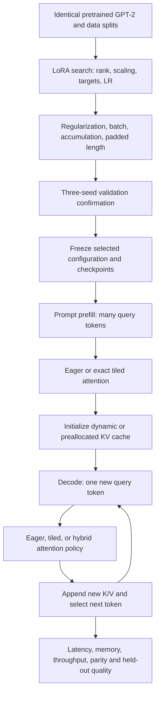

# Methodology draft

## 1. Low-rank adaptation

Start from the same GPT-2 pretrained checkpoint for every candidate. Freeze the original parameters and train low-rank updates W' = W + (alpha/r)BA. Sweep rank, alpha/r, learning rate, and target projections jointly. Then evaluate dropout, weight decay, effective batch size, gradient accumulation, and padded sequence length around the strongest candidates. Record validation answer-token NLL, trainable parameters, peak training memory, update time, examples processed and successful update count. Select checkpoints on validation NLL and confirm finalists across three seeds. The resulting choice is the best observed configuration under a stated budget.

## 2. Exact tiled attention

Replace materialized attention with a custom FA1-derived online-softmax implementation. Keep weights, dtype, causal masking, prompts, and output lengths fixed while sweeping query tile 16/32, key tile 32/64, and warps 4/8. Test forward outputs and backward gradients against eager attention before running the study. This implementation illustrates the FA1 algorithm but does not establish the performance of optimized production FlashAttention. Primary results use IEEE FP32 dots with TF32 disabled. FP16 is a separate optional experiment.

## 3. KV caching

Compare recomputing prefixes with reusing past K/V during autoregressive inference. Sweep request batch size, prompt length and output length. Compare the existing concatenating cache with a full-capacity preallocated cache. Report prefill latency, latency per subsequent token, total request latency, throughput, peak allocated/reserved bytes, logical KV occupancy and preallocated capacity. Confirm cached logits and generated tokens against uncached execution. No quantization, eviction or context truncation is used in these comparisons.

## 4. Combined framework and interactions

LoRA changes which parameters train and the deployed projection work. Attention tiling changes attention's memory movement. Caching eliminates repeated projection/MLP computation for old tokens but retains a growing K/V state. Each mechanism acts at a different point in the same forward pass. Their speedups should therefore be measured together rather than multiplied as independent constants.

Use the eight primary inference cells: full/LoRA × eager/tiled × cache off/dynamic. “Full” denotes a tuned full-fine-tuned checkpoint; it is not the original untouched pretrained model. Compare kernels and caching within each fixed checkpoint. Differences between full and LoRA also include differences in learned weights, so held-out quality accompanies performance. Full tuning has three LR candidates while LoRA has a broader search; disclose the unequal total tuning cost and avoid attributing all quality differences solely to adaptation method.

For each fixed method, workload and GPU, report the interaction ratio:

`interaction = (T_eager_off / T_tiled_off) / (T_eager_cached / T_tiled_cached)`

Values above one mean tiling's measured benefit shrinks with caching. Report the constituent latencies and seed/repetition variability; the ratio alone is insufficient. This is a descriptive interaction, not evidence of an inherent incompatibility.

Two concrete interventions test the proposed explanation: tiled prefill with eager single-query decode, and preallocated rather than concatenated KV storage. The first addresses query-parallelism loss during decode; the second removes repeated cache concatenation but reserves more memory and may still incur layout copies in the prototype. Neither improvement is assumed in advance. Split-KV/Flash-Decoding is an evidence-backed follow-up if the single-query kernel remains the bottleneck; it is not implemented here.

Report quality/cost Pareto candidates, not just one fastest or lowest-loss point. A configuration is dominated only when another measured configuration is no worse on both validation NLL and cost, with at least one strict improvement. Distinguish training cost, deployment latency, memory, and total search cost. Results apply to the fictional sports task and GPT-2 on the measured GPU; they do not establish universal hyperparameters for transformer models.
