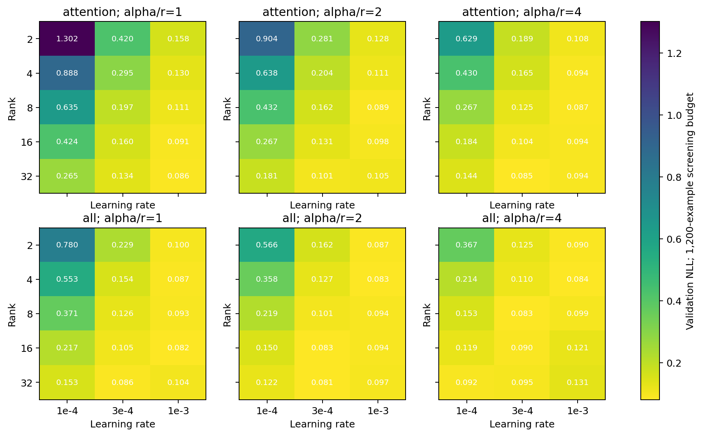
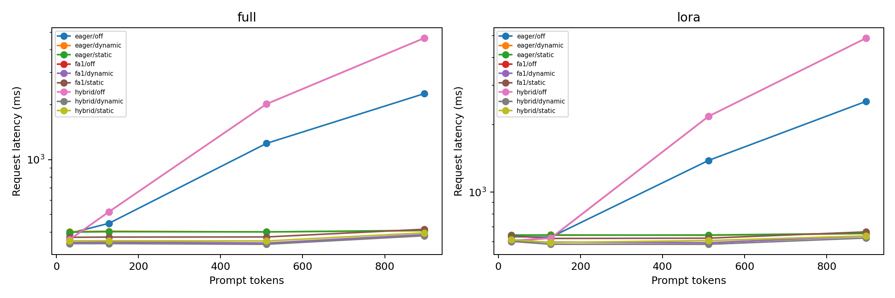

# Hyperparameter and combined-systems analysis

Completed training trials: 127.
Selections use validation NLL; held-out test scores do not change the chosen configuration.

## Core search

90/90 screening configurations completed.


## Full-budget training

25 unique seed-42 trials; 8 on the observed quality/time/memory Pareto front.
Pareto comparisons require the same GPU model. Training cost sums all update times; it excludes validation, loading and checkpoint I/O.
Detailed configurations are in TRIALS.csv; Pareto candidates are in PARETO.csv.

## Frozen validation choice

```json
{
  "method": "lora",
  "rank": 32,
  "scale": 2.0,
  "lr": 0.0003,
  "targets": "all",
  "dropout": 0.05,
  "weight_decay": 0.01,
  "batch": 4,
  "microbatch": 4,
  "length": 128
}
```

| Candidate | Mean validation NLL | Seed standard deviation |
|---|---|---|
| 1 | 0.016746 | 0.009248 |
| 2 | 0.021946 | 0.002751 |
| 3 | 0.030422 | 0.011980 |

## Combined systems

1440 successful cells; 0 OOM cells.
SYSTEMS.csv includes raw-cell medians and repetition standard deviations. INTERACTIONS.csv fixes tile geometry for the cache comparison.
The fastest measured configuration below is a workload-specific performance result; correctness parity is required. It is not a quality-selection criterion.

| Method | Batch | Prompt | Output | Fastest backend | Cache | Tiles / warps | Request ms |
|---|---|---|---|---|---|---|---|
| full | 1 | 32 | 32 | hybrid | dynamic | 16/32/4 | 174.49 |
| full | 1 | 32 | 64 | hybrid | dynamic | 16/32/4 | 346.50 |
| full | 1 | 128 | 32 | hybrid | dynamic | 16/32/4 | 175.60 |
| full | 1 | 128 | 64 | hybrid | dynamic | 16/32/4 | 346.73 |
| full | 1 | 512 | 32 | hybrid | dynamic | 16/32/4 | 173.37 |
| full | 1 | 512 | 64 | hybrid | dynamic | 16/32/4 | 343.69 |
| full | 1 | 896 | 32 | fa1 | dynamic | 32/64/8 | 196.66 |
| full | 1 | 896 | 64 | fa1 | dynamic | 32/64/8 | 369.23 |
| full | 4 | 32 | 32 | hybrid | dynamic | 16/32/4 | 188.79 |
| full | 4 | 32 | 64 | hybrid | dynamic | 16/32/4 | 381.64 |
| full | 4 | 128 | 32 | hybrid | dynamic | 16/32/4 | 187.42 |
| full | 4 | 128 | 64 | hybrid | dynamic | 16/32/4 | 369.12 |
| full | 4 | 512 | 32 | fa1 | dynamic | 32/64/8 | 225.60 |
| full | 4 | 512 | 64 | fa1 | dynamic | 32/64/8 | 407.63 |
| full | 4 | 896 | 32 | fa1 | dynamic | 32/64/8 | 271.44 |
| full | 4 | 896 | 64 | fa1 | dynamic | 32/64/8 | 455.39 |
| full | 8 | 32 | 32 | hybrid | dynamic | 16/32/4 | 186.86 |
| full | 8 | 32 | 64 | hybrid | dynamic | 16/32/4 | 369.57 |
| full | 8 | 128 | 32 | hybrid | dynamic | 16/32/4 | 186.82 |
| full | 8 | 128 | 64 | hybrid | dynamic | 16/32/4 | 367.83 |
| full | 8 | 512 | 32 | fa1 | dynamic | 16/64/4 | 280.18 |
| full | 8 | 512 | 64 | fa1 | dynamic | 16/64/4 | 458.50 |
| full | 8 | 896 | 32 | hybrid | static | 16/32/4 | 403.03 |
| full | 8 | 896 | 64 | hybrid | static | 16/32/4 | 593.60 |
| lora | 1 | 32 | 32 | hybrid | dynamic | 16/32/4 | 295.32 |
| lora | 1 | 32 | 64 | fa1 | dynamic | 32/32/4 | 597.46 |
| lora | 1 | 128 | 32 | hybrid | dynamic | 16/32/4 | 294.13 |
| lora | 1 | 128 | 64 | hybrid | dynamic | 16/32/4 | 585.45 |
| lora | 1 | 512 | 32 | hybrid | dynamic | 16/32/4 | 293.68 |
| lora | 1 | 512 | 64 | hybrid | dynamic | 16/32/4 | 585.23 |
| lora | 1 | 896 | 32 | fa1 | dynamic | 32/64/8 | 321.86 |
| lora | 1 | 896 | 64 | fa1 | dynamic | 32/64/8 | 618.03 |
| lora | 4 | 32 | 32 | hybrid | static | 16/32/4 | 299.89 |
| lora | 4 | 32 | 64 | hybrid | dynamic | 16/32/4 | 595.30 |
| lora | 4 | 128 | 32 | hybrid | dynamic | 16/32/4 | 296.01 |
| lora | 4 | 128 | 64 | hybrid | dynamic | 16/32/4 | 587.41 |
| lora | 4 | 512 | 32 | hybrid | dynamic | 16/32/4 | 342.18 |
| lora | 4 | 512 | 64 | hybrid | dynamic | 16/32/4 | 633.66 |
| lora | 4 | 896 | 32 | fa1 | dynamic | 32/64/8 | 395.07 |
| lora | 4 | 896 | 64 | fa1 | dynamic | 32/64/8 | 693.99 |
| lora | 8 | 32 | 32 | hybrid | dynamic | 16/32/4 | 298.25 |
| lora | 8 | 32 | 64 | hybrid | dynamic | 16/32/4 | 588.59 |
| lora | 8 | 128 | 32 | hybrid | dynamic | 16/32/4 | 296.27 |
| lora | 8 | 128 | 64 | hybrid | dynamic | 16/32/4 | 588.84 |
| lora | 8 | 512 | 32 | fa1 | dynamic | 16/64/4 | 398.40 |
| lora | 8 | 512 | 64 | fa1 | dynamic | 16/64/4 | 694.84 |
| lora | 8 | 896 | 32 | fa1 | dynamic | 16/64/4 | 512.37 |
| lora | 8 | 896 | 64 | fa1 | dynamic | 16/64/4 | 800.17 |




## full: held-out test

| Metric | Mean | Seed SD |
|---|---|---|
| primary_correct | 0.2444 | 0.0647 |
| score_numbers_correct | 0.9972 | 0.0048 |
| fields_correct | 0.2417 | 0.0682 |
| reference_exact | 0.1639 | 0.1339 |
Completed seeds: 3/3. Seed variability is not a confidence interval over unseen datasets.


## lora: held-out test

| Metric | Mean | Seed SD |
|---|---|---|
| primary_correct | 0.9333 | 0.0946 |
| score_numbers_correct | 0.9917 | 0.0144 |
| fields_correct | 0.9306 | 0.0929 |
| reference_exact | 0.9306 | 0.0929 |
Completed seeds: 3/3. Seed variability is not a confidence interval over unseen datasets.


Hardware and budget limits: primary training and systems jobs request the academic A30 partition. Check actual GPU and software metadata before pooling runs. Full fine-tuning gets a smaller tuning budget than LoRA. Longer padded sequences do not add task context. See README.md and METHODS.md for the complete protocol.
