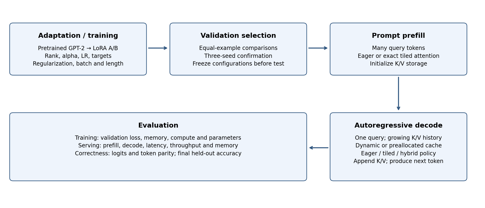
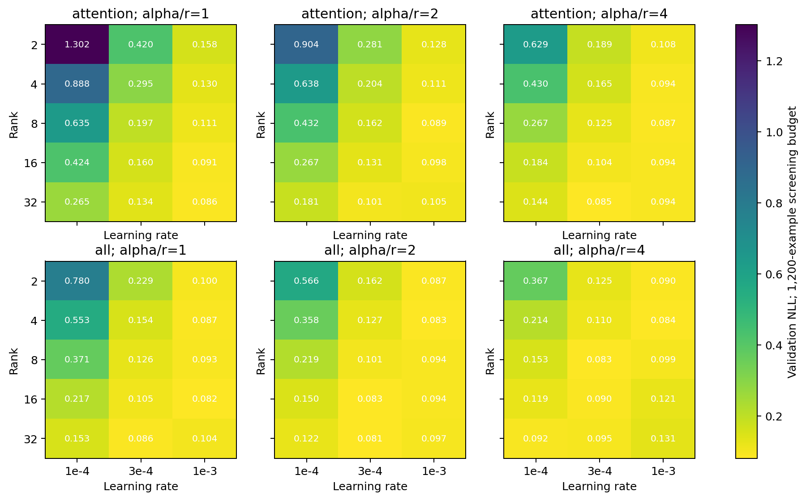
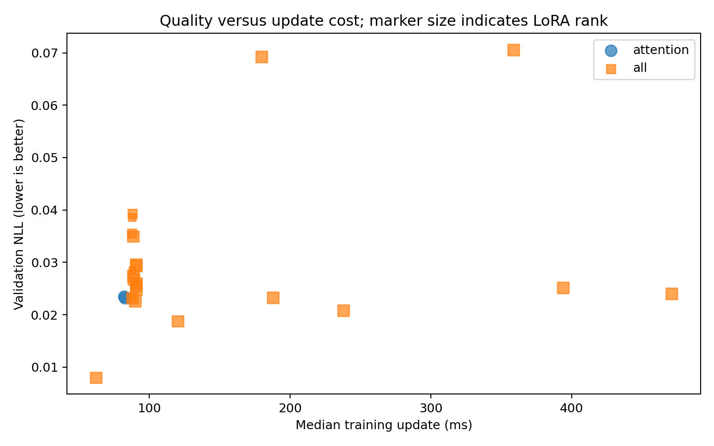
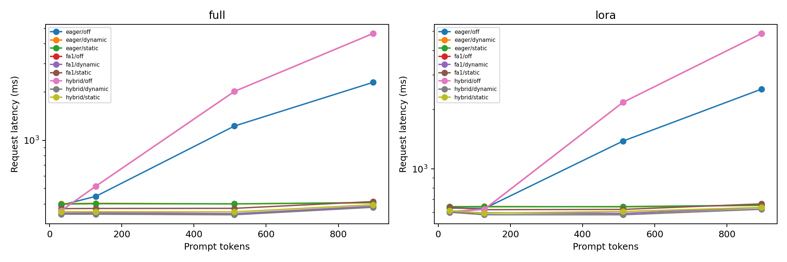

# Final report: tuning LoRA, tiled attention and KV caching

Completed November 3, 2026. GPT-2 / fictional sports question answering / NVIDIA A30 / FP32 with TF32 disabled.

## 1. Findings

The staged search completed 127 unique training trials and 1,440 combined serving configurations. Every serving configuration passed the required eager-reference logit tolerance and greedy-token parity checks; no measured cell ran out of memory. Each cell retains seven timing repetitions after two warmups.

The selected configuration is rank 32, alpha 64, learning rate 0.0003, all attention and MLP projections, LoRA input dropout 0.05, AdamW weight decay 0.01, effective batch 4, microbatch 4, and padded training length 128. It achieved mean validation answer-token NLL 0.016746 with seed standard deviation 0.009248 across seeds 42, 43 and 44. This is the best observed configuration within the staged search.

Held-out answer-field accuracy averaged 93.06% for selected LoRA and 24.17% for the selected full-fine-tuning control. This is a task-specific result with unequal search budgets: LoRA received a broad search while full fine-tuning received three learning rates. It does not establish general superiority of LoRA.

Caching produced large latency gains for long prompts. The preferred attention/cache configuration depended on workload. Unmerged adapters added inference work, so the selected LoRA model was slower than the full control at short prompts despite its training-memory and parameter advantages.

## 2. Methodology

### 2.1 LoRA

Start every candidate from identical pretrained weights. Freeze the base and train W + (alpha/r)BA at the fused Q/K/V and attention output projections; the all-target variant also adapts both MLP projections. Adapter dropout acts before A only. The selected model trains 4,718,592 of 167,755,776 stored parameters (2.81%). The minGPT implementation stores an untied output head, so its total parameter count differs from tied-weight GPT-2 counts.

### 2.2 Exact tiled attention

The implementation is a local FA1-derived Algorithm 1/4 prototype with K/V tiles outer and query tiles inner. Query tiles 16/32, key tiles 32/64 and warps 4/8 form eight settings. This is not the original optimized FA1 CUDA kernel or production FA2/3/4. No PyTorch FlashAttention backend is used in this study. Training hyperparameter selection uses eager attention throughout; attention settings are serving ablations on frozen selected checkpoints.

### 2.3 KV caching

Compare uncached prefix recomputation, dynamic concatenating KV storage, and preallocated full-context KV storage. Requests are serial within each model, use equal-length dense batches, and stay within 1,024 position tokens. Static capacity and logical used-cache bytes are distinct metrics. The preallocated variant still incurs any layout copies required by the attention prototype.

### 2.4 Combined design and fair comparison

The primary factorial comparison uses full/LoRA × eager/tiled × cache off/dynamic. Additional factors are a hybrid policy with tiled prefill and eager single-token decode, static caching, attention tile geometry, batch 1/4/8, prompt 32/128/512/896 and generation 32/64. The 1,440 cells include hybrid/off controls, which provide repeated timing controls because all uncached queries have length greater than one.

Each within-model comparison uses the same checkpoint and synthetic prompt. Timed generation emits exactly the requested token count; quality evaluation trims at EOS. CUDA events measure prefill/decode, host wall time measures total request latency, and allocated/reserved memory is retained in raw samples. Cases run in fixed order, so drift and thermal/order effects remain limitations. Timing warmups exclude kernel compilation. Speed comparisons are descriptive and do not include cross-run confidence intervals.

## 3. Search protocol

| Stage | Search | Budget |
| --- | --- | --- |
| Core | 5 ranks × 3 scales × 3 LRs × 2 target sets = 90 | 1,200 examples each |
| Refine | Top 9 core candidates | 9,600 examples each |
| Regularize | 3 dropout × 3 decay settings | 9,600 examples each |
| Batch / memory / length | Batch 4/8/16/32; microbatch 1/2/4/8; length 128/256/512 | 9,600 examples each |
| Confirm | Top 3 unique candidates × seeds 42/43/44 | 9,600 examples per seed |
| Full control | LR 1e-4/3e-4/1e-3; selected LR repeated on seeds 43/44 | 9,600 examples per run |

Completed duplicate configurations are reused; stage counts therefore exceed the 127 unique trials when summed. Validation selects checkpoints and candidates. Only the frozen selected LoRA and full configurations receive held-out evaluation. Core screening is exhaustive over its four dimensions; later stages are conditional searches. Short screening can eliminate candidates that improve later.

The data contains 1,440 training, 120 validation and 120 test rows. Test team names are absent from training. Microbatch losses are weighted by supervised-token counts. Identical seeds yield the same flattened sampled-example stream. At equal 9,600 examples, batch 4 receives 2,400 optimizer updates and batch 32 receives 300: batch effects include a changed update budget. With dropout enabled, microbatch partitioning also changes RNG consumption, so different validation losses are not solely accumulation-rounding effects.

## 4. Hyperparameter findings

### 4.1 Rank, scaling, LR and targets

The table below contains the nine candidates promoted to full-budget refinement, all at batch/microbatch 8, length 128, dropout 0 and decay 0. These are seed-42 results, not independent three-seed confirmations of every rank.

| Rank | Alpha | LR | Targets | Validation NLL | Update ms |
| --- | --- | --- | --- | --- | --- |
| 32 | 64 | 0.0003 | all | 0.023162 | 87.77 |
| 32 | 32 | 0.001 | attention | 0.023164 | 82.80 |
| 4 | 16 | 0.001 | all | 0.023254 | 87.96 |
| 32 | 128 | 0.0003 | attention | 0.023444 | 82.24 |
| 4 | 8 | 0.001 | all | 0.028533 | 87.95 |
| 32 | 32 | 0.0003 | all | 0.034962 | 88.55 |
| 16 | 16 | 0.001 | all | 0.035487 | 87.83 |
| 8 | 32 | 0.0003 | all | 0.038647 | 87.87 |
| 16 | 32 | 0.0003 | all | 0.039303 | 88.08 |

Rank 4 with alpha 16 and LR 0.001 nearly matched the best unregularized rank-32 refinement loss (0.023254 versus 0.023162). Rank 32 is the winner of the subsequent conditional search; the study did not exhaustively retune regularization and batching around rank 4. Do not claim that high rank is necessary.

### 4.2 Regularization

| Dropout | Decay | Validation NLL | Update ms |
| --- | --- | --- | --- |
| 0.05 | 0.01 | 0.022593 | 90.11 |
| 0.0 | 0.0 | 0.023162 | 87.77 |
| 0.05 | 0.1 | 0.024810 | 90.60 |
| 0.1 | 0.1 | 0.025522 | 90.61 |
| 0.1 | 0.01 | 0.025994 | 90.69 |
| 0.0 | 0.1 | 0.026792 | 89.06 |
| 0.0 | 0.01 | 0.027463 | 88.59 |
| 0.05 | 0.0 | 0.029379 | 90.51 |
| 0.1 | 0.0 | 0.029637 | 90.75 |

Dropout 0.05 with decay 0.01 was the strongest seed-42 regularization pair. Its small gain over dropout/decay zero at batch 8 should be treated as a selected observation rather than an isolated causal effect or statistically resolved improvement.

### 4.3 Batch, accumulation and padded sequence length

| Batch | Micro | Length | Updates | Validation NLL | Compute s | Peak GiB |
| --- | --- | --- | --- | --- | --- | --- |
| 4 | 4 | 128 | 2400 | 0.008009 | 147.7 | 1.65 |
| 8 | 1 | 128 | 1200 | 0.024037 | 566.8 | 1.13 |
| 8 | 2 | 128 | 1200 | 0.020831 | 284.4 | 1.21 |
| 8 | 4 | 128 | 1200 | 0.018789 | 144.4 | 1.66 |
| 8 | 8 | 128 | 1200 | 0.022593 | 108.3 | 2.54 |
| 16 | 8 | 128 | 600 | 0.069265 | 107.8 | 2.55 |
| 32 | 8 | 128 | 300 | 0.070588 | 107.7 | 2.55 |
| 8 | 8 | 256 | 1200 | 0.023247 | 225.5 | 4.66 |
| 8 | 8 | 512 | 1200 | 0.025192 | 472.6 | 9.84 |

Smaller microbatches reduced memory but increased runtime. Increasing padded length from 128 to 256/512 increased update time from 90.11 ms to 187.88/393.78 ms without improving the selected validation loss. The task examples already fit within 128 tokens; this is a padding-cost experiment, not evidence about learning longer real contexts. Peak training allocation is sampled after updates; the CUDA high-water mark may include an earlier validation pass.

### 4.4 Three-seed confirmation

| Batch | Microbatch | Mean validation NLL | Seed SD |
| --- | --- | --- | --- |
| 4 | 4 | 0.016746 | 0.009248 |
| 8 | 4 | 0.021946 | 0.002751 |
| 8 | 2 | 0.030422 | 0.011980 |

The batch-4 candidate wins on mean validation loss; batch 8/microbatch 4 has lower seed variance. Three seeds provide limited precision and do not establish significance of the difference.

## 5. Held-out quality and training cost

| Metric | Full mean | Full seed SD | LoRA mean | LoRA seed SD |
| --- | --- | --- | --- | --- |
| primary_correct | 24.44% | 6.47 pp | 93.33% | 9.46 pp |
| score_numbers_correct | 99.72% | 0.48 pp | 99.17% | 1.44 pp |
| fields_correct | 24.17% | 6.82 pp | 93.06% | 9.29 pp |
| reference_exact | 16.39% | 13.39 pp | 93.06% | 9.29 pp |

Answer-field correctness requires both the primary answer and expected score numbers. The evaluation is on 120 shared test questions per seed; the 360 scored answers per method are not 360 independent questions. Seed SD describes training-run variability, not a confidence interval over new datasets. LoRA answer-field results were 96.67%, 82.50% and 100.00%; full-control results were 18.33%, 31.67% and 22.50%.

| Method | Trainable parameters | Mean compute seconds | Mean peak GiB |
| --- | --- | --- | --- |
| full | 163,037,184 | 177.6 | 3.12 |
| lora | 4,718,592 | 144.6 | 1.65 |

These costs cover all 9,600-example training updates, even when an earlier checkpoint wins. They exclude model loading, validation and checkpoint I/O. The full control trains all parameters; LoRA-specific dropout/target/rank entries in its shared config schema do not apply to full fine-tuning. This comparison uses the selected LR and the winner-derived batch, length and weight decay; the full control did not receive a matching broad optimizer/batch search.

## 6. Combined LoRA, attention and cache results

### 6.1 Primary eight-cell comparison

Fixed workload: batch 8, prompt 896, output 64; fixed tiles 16/32, warps 4. Values are medians of seven repetitions. Logical cache occupancy is additional state, and static capacity is excluded here because the primary comparison uses the dynamic cache.

| Method | Attention | Cache | Request ms | Prefill ms | Decode ms/token | Peak GiB |
| --- | --- | --- | --- | --- | --- | --- |
| full | eager | off | 16720.73 | 245.56 | 261.51 | 1.47 |
| full | eager | dynamic | 633.21 | 240.93 | 6.22 | 2.05 |
| full | fa1 | off | 16227.25 | 241.04 | 253.78 | 1.14 |
| full | fa1 | dynamic | 751.18 | 241.06 | 8.09 | 1.92 |
| lora | eager | off | 18412.38 | 270.78 | 287.95 | 1.48 |
| lora | eager | dynamic | 874.11 | 264.83 | 9.66 | 2.07 |
| lora | fa1 | off | 17993.39 | 265.28 | 281.39 | 1.15 |
| lora | fa1 | dynamic | 895.09 | 263.24 | 10.01 | 1.93 |

For selected LoRA at this long workload, eager caching reduced request latency from 18,412.38 ms to 874.11 ms (21.06x). Tiled attention at default geometry with dynamic cache took 895.09 ms, slightly slower than eager cached. Hybrid dynamic took 817.22 ms. The fastest measured LoRA cell used tiled dynamic with tiles 16/64 and four warps at 800.17 ms (23.01x versus eager uncached, and 1.09x versus eager cached). Best-of-grid timings are selected performance observations and can contain selection noise.

At batch 1, prompt 512, output 64, default tiled attention slowed uncached LoRA generation (2,179.61 ms versus eager 1,385.28 ms), while tiled dynamic caching beat eager dynamic (594.70 ms versus 641.62 ms). Thus the attention/cache interaction is workload-dependent; caching does not universally diminish attention acceleration.

### 6.2 Mitigations and tile tuning

At batch 8/prompt 896/output 64, hybrid dynamic reduced LoRA request time from the default tiled/dynamic 895.09 ms to 817.22 ms. Static storage improved default tiled latency to 850.87 ms and reduced peak allocation from about 1.94 GiB to 1.69 GiB, but hybrid/static was slower than hybrid/dynamic (830.61 versus 817.22 ms). Preallocation reserves full context capacity and can be less attractive at short contexts. These measurements support tuning the combination rather than selecting each mechanism independently.

The attention/cache interaction ratio is (eager-off/tiled-off)/(eager-dynamic/tiled-dynamic), computed at fixed geometry for every workload in INTERACTIONS.csv. Ratios above one indicate that tiling benefit shrinks with caching; values below one indicate the opposite. Raw latency and variation must accompany this descriptive ratio. SYSTEMS.csv includes all eight tile/warp settings and all cache modes; ANALYSIS.md lists the fastest observed setting per workload.

## 7. Related work and scope

### Primary-source review

Sources checked November 3, 2026. This is a focused primary-source review, not a systematic literature survey.

| Work | Evidence relevant to this study | Implication |
|---|---|---|
| [S-LoRA, 2023; ICML 2024 version](https://arxiv.org/abs/2311.03285) | Serves heterogeneous low-rank adapters and manages adapter weights and KV tensors through unified paging | Prior integration of LoRA and cache management exists. Do not claim that combining mechanisms is itself novel. This review does not establish an identical three-factor experiment or identical attention implementation. |
| [Flash-Decoding, 2023, Stanford CRFM](https://crfm.stanford.edu/2023/10/12/flashdecoding) | Splits attention across the KV dimension to expose parallelism when queries are short | Separate prefill from decode; test whether a single-query policy helps. A tiled prefill kernel need not be the best decode kernel. |
| [Rank-stabilized LoRA, 2023](https://arxiv.org/abs/2312.03732) | Studies how rank-dependent scaling affects learning and proposes square-root rank scaling | Rank and scale must be considered jointly. The present grid varies alpha/r explicitly; it does not evaluate rsLoRA as a separate method. |
| [FlashAttention-3, 2024](https://arxiv.org/abs/2407.08608) | Hardware-aware asynchronous pipelines target Hopper, with low-precision execution | FA generations and hardware matter. A30 FP32 prototype results cannot be presented as FA3 results. |
| [LoRA Without Regret, 2025, original authors](https://doi.org/10.64434/tml.20250929) | Sweeps rank and learning rate in supervised adaptation experiments | Compare tuning budgets explicitly and evaluate rank/LR interactions rather than treating rank 4 as universally sufficient. |
| [Learning Rate Matters: Vanilla LoRA May Suffice for LLM Fine-tuning, 2026](https://arxiv.org/abs/2602.04998) | Re-evaluates LoRA variants with extensive searches and reports method-dependent LR preferences | Strong tuning controls are needed before attributing quality differences to the adaptation method. |
| [Learning Rate Scaling across LoRA Ranks and Transfer to Full Finetuning, 2026](https://arxiv.org/abs/2602.06204) | Studies LR scaling with rank, initialization and adapter scaling | Rank × scale × LR is an appropriate joint core grid; conclusions are conditional on the initialization and scaling used. |
| [FlashAttention-4, 2026](https://arxiv.org/abs/2603.05451) and [official repository](https://github.com/Dao-AILab/flash-attention) | New kernel/algorithm co-design; official implementation is written in CuTeDSL and targets Hopper/Blackwell | Include FA4 in recent-advances discussion while distinguishing it from the local FA1-derived prototype. |

The defensible contribution is a reproducible, precision-controlled account of training quality and serving costs for the selected mechanisms on this implementation. Existing LoRA-serving work weakens a broad “first to combine all three” claim. Establishing whether any prior paper performs the exact same factorial experiment requires a broader full-text review; it has not been established here.

The cache/attention conflict is a hypothesis about workload shape and memory movement: caching reduces the query dimension to one while K/V length grows, limiting query-tile parallelism. Cache concatenation and noncontiguous-to-contiguous copies may add overhead. Model-wide projection/MLP time can dominate attention time at short contexts. The study measures these effects through separate prefill/decode timings, cache allocation variants, and the hybrid policy rather than assuming attention acceleration must improve total request latency.

Additional dimensions to consider after the primary study are rsLoRA versus classic scaling, separate A/B learning rates, warmup/scheduler choice, per-layer rank allocation, merged versus unmerged adapters, split-KV decode, cache paging and chunked prefill. These are follow-up interventions, not measured outcomes of the current runner.

## 8. Limitations and next experiments

The full precision study is complete. FP16 was optional and was not run. Results describe a custom FP32 FA1-derived prototype on A30, one small task and this minGPT implementation. They do not measure production FA2/3/4, lossy/quantized caches, paging, split-KV decode or merged LoRA. A merged-adapter serving ablation is a useful next step because unmerged A/B computation is visible in inference latency.

The top-three confirmation candidates all share rank 32 and differ in batch/microbatch. Lower-rank candidates remain competitive in seed-42 refinement, and full fine-tuning had less tuning compute. The broad conclusion is that tuning materially affects outcomes, with workload-specific combinations for inference; universal hyperparameters and method superiority remain unestablished.

## 9. Reproducibility and artifacts

127 completed unique trials; 1,440/1,440 serving cells passed; 10,080 measured serving repetitions plus warmups. The preliminary GPU gate passed 24 attention forward/backward cases and 18 full-model cache/backend cases. Data/source hashes, exact source snapshots, trial checkpoints, sample-stream hashes, raw timing samples, raw test outputs and Slurm job logs are retained. See source_hashes.json, snapshot_hashes.json, source/, trials/, systems-0/1/2.json and logs/.

The complete machine-readable tables are TRIALS.csv, PARETO.csv, SYSTEMS.csv and INTERACTIONS.csv. selection.json records the frozen validation choice. framework.svg is a standalone export; METHODS.md retains an editable Mermaid diagram. FINAL_REPORT.md is editable, FINAL_REPORT.html embeds all figures, and FINAL_REPORT.pdf is printable.
