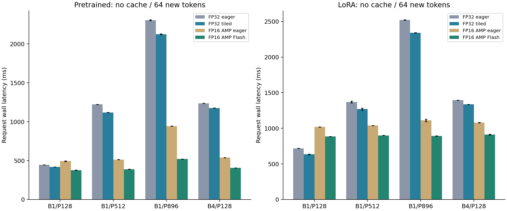
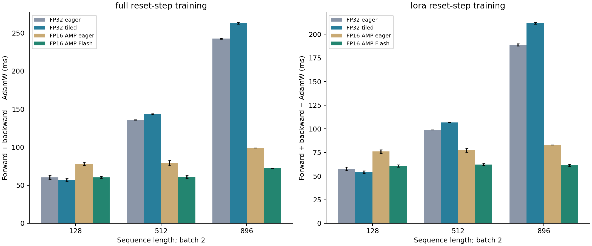
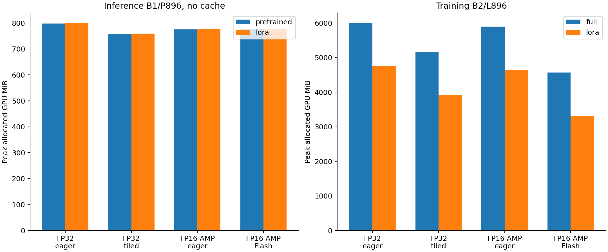

# Main FP16/FP32 attention comparison

## First: what the backend names mean

**One PyTorch model; different attention implementations**

| Name | Execution | Role |
| --- | --- | --- |
| Eager | Separate matmul/mask/softmax | Original minGPT baseline |
| Tiled FP32 | Custom Triton online-softmax tiles | FP32 forward AND backward |
| Flash | Forced PyTorch FlashAttention | FP16 attention in this run |
| Math | PyTorch SDPA math reference | Validation; not main speed baseline |
| Efficient | Separate PyTorch SDPA backend | Prior FP32 FastF32 experiment |

**Same equation; different execution**

All compute softmax(Q K^T / sqrt(head_width) + causal_mask) V. Eager materializes the score/probability matrices. Tiled attention processes blocks with running softmax state; its backward recomputes block probabilities. Flash uses a heavily optimized fused CUDA implementation of tiled attention. Eager also executes CUDA kernels: it does not mean CPU.

**Why these are distinct**

Tiled FP32 is our custom implementation, not the official FlashAttention CUDA backend with its dtype check removed. Our dot products request IEEE FP32. PyTorch FlashAttention here receives FP16 Q/K/V. Internal accumulation and rounding can differ even with matched input precision.

**Why math and efficient are not the main comparison**

Math is a useful reference, but FP16 math normally uses FP32 intermediates and can be slower/more memory-intensive than eager. The installed efficient FP32 kernel uses a FastF32 Tensor Core specialization; FP32 tensors alone do not establish IEEE FP32 multiplication. Neither backend is used as the main performance baseline here.

## Fair comparisons and precision policy

**The four comparisons**

| Ratio (baseline / candidate) | What it measures |
| --- | --- |
| FP32 eager / FP32 tiled | Implementation at fixed FP32 |
| FP16 eager / FP16 Flash | Flash backend at fixed FP16 policy |
| FP32 eager / FP16 eager | Precision-policy change |
| FP32 eager / FP16 Flash | Combined practical change |

**Identical master parameters**

All four main variants use the SAME FP32 model and checkpoint. FP16 rows enable FP16 autocast for both eager and Flash. Inference therefore measures AMP FP16 with FP32 master weights, not native FP16 model storage. Weight-casting/cache costs are included. Holding master weights fixed avoids quantizing model storage between paired requests.

**Training policy**

All rows use FP32 master parameters and AdamW states. Both FP16 variants use identical GradScaler settings: initial scale 128, large growth interval. Every recorded step must have finite gradients, scale 128 and exactly one optimizer update. FP32-to-FP16 ratios include required casting/scaling overhead; they are not pure hardware-bitwidth ratios.

**Historical results**

The earlier BF16 report used native BF16 inference weights; the earlier FP32 tiled report had forward only and sequential backend blocks. Those results remain valid historical measurements, but must not be relabeled FP16 or pooled with this different paired AMP protocol. Native FP16 serving could have different latency and memory.

## Measured findings and experiment scope

**Measured results**

At batch 1 / prompt 896 / 64 generated tokens, pretrained FP32 eager takes 2306.5 ms; FP32 tiled takes 2124.8 ms (1.09x). FP16 AMP eager takes 943.9 ms and FP16 Flash takes 521.0 ms (1.81x at fixed FP16 policy).
At training batch 2 / length 896, full FP32 eager takes 242.5 ms and tiled FP32 262.8 ms (0.92x); peaks are 5997 and 5168 MiB. A ratio below one means slower, even if memory improves.

**Hardware**

NVIDIA A30; job 2419701 on gpu-4-21.int.turing.wpi.edu. PyTorch 2.14.0+cu130, CUDA 13.0, Triton 3.8.0. Started 2026-10-27T18:00:39Z. TF32 disabled. Same allocation, one resident model, one CPU intra-op thread. Three warmups and seven measured repetitions per mode/case.

**Inference controls**

Pretrained GPT-2 and trained seed-42 unmerged LoRA. B1/P128, B1/P512, B1/P896 and B4/P128; cache off/on; 64 new tokens with no early EOS stopping. All eight precision/backend/cache modes are shuffled each repetition. Timings include prefill, selection/append and decode; exclude loading, transfers, compilation, warmups and cleanup.

**Training controls**

Batch 2; lengths 128/512/896. Every individual trial resets original weights, zero AdamW moments and step=0; same batch across methods and variants. State copies/reset and gradient clearing are outside timing; forward, backward, loss scaling and AdamW update are inside. Variants are shuffled every repetition. This measures reset-step cost, not convergence or time to target quality.

## FP32 backward: implementation and validation

**What changed**

Forward saves Q/K/V, output and one FP32 log-normalizer per query. Backward forms delta=sum(output*doutput), then recomputes probabilities in tiles to accumulate dQ, dK and dV. No globally materialized quadratic score/probability matrix is saved or recomputed. Key/value tiles own their gradients without atomics. Noncontiguous-input/upstream-gradient copies are linear-size and included in measured costs.

**Real-checkpoint gradients versus FP32 eager**

| Model | Variant | Loss error | Grad rel L2 | Grad max abs |
| --- | --- | --- | --- | --- |
| pretrained | fp32_eager | 0.00e+00 | 0.00e+00 | 0.00e+00 |
| pretrained | fp32_tiled | 9.54e-07 | 1.14e-06 | 5.01e-06 |
| pretrained | fp16_eager | 2.10e-04 | 2.79e-03 | 7.48e-03 |
| pretrained | fp16_flash | 9.50e-04 | 2.58e-03 | 5.92e-03 |
| lora | fp32_eager | 0.00e+00 | 0.00e+00 | 0.00e+00 |
| lora | fp32_tiled | 0.00e+00 | 1.19e-06 | 4.92e-07 |
| lora | fp16_eager | 8.30e-05 | 6.16e-03 | 1.45e-03 |
| lora | fp16_flash | 1.17e-03 | 3.00e-03 | 1.97e-03 |

**Validation evidence**

11-method attention suite passed on the GPU worker with no failures/errors/skips. It includes float64 forward/gradient references, odd/cached lengths, noncontiguous layouts, real model/LoRA gradients, four AdamW updates, linear saved-state checks and compiled forward/backward FP32 precision. All 168 measured optimizer steps were successful and finite; no overflow-skipped steps were counted.

**Current limits**

First-order gradients only; no higher-order derivatives or attention dropout. Dropout is zero in every measured variant. FP32 GPU exp/log approximations and reduction order prevent a bitwise-equivalence promise. The kernel is a fixed-tile prototype: implementing backward enables a legitimate training comparison, not an assumption of a speed win.

## Pretrained: inference comparisons

**B1/P896: median request milliseconds**

| Variant | No cache | Cache | Cache gain | Backend gain* |
| --- | --- | --- | --- | --- |
| FP32 eager | 2306.5 | 405.2 | 5.69x | 1.00x |
| FP32 tiled | 2124.8 | 335.0 | 6.34x | 1.09x |
| FP16 AMP eager | 943.9 | 503.4 | 1.88x | 1.00x |
| FP16 AMP Flash | 521.0 | 404.4 | 1.29x | 1.81x |

**No-cache speedup attribution at all shapes**

| B/P | FP32 tiled | FP16 Flash | Precision | Combined |
| --- | --- | --- | --- | --- |
| 1/128 | 1.06x | 1.31x | 0.90x | 1.18x |
| 1/512 | 1.09x | 1.32x | 2.38x | 3.14x |
| 1/896 | 1.09x | 1.81x | 2.44x | 4.43x |
| 4/128 | 1.05x | 1.32x | 2.30x | 3.04x |

**Definitions**

*Backend gain compares to eager at the SAME precision policy. Cache gain is no-cache/cache within a variant. Precision is FP32 eager/FP16 AMP eager; combined is FP32 eager/FP16 Flash. Ratios below one are slowdowns. Cached token throughput, prefill and decode CUDA-event metrics, memory and every raw sample are retained in CSV/JSON.

**Interpretation**

Flash, cache and LoRA effects must be read from their measured combinations, not multiplied from unrelated workloads. Unmerged LoRA adds projection work. AMP behavior can differ for frozen versus trainable weights; these measurements do not establish optimal native-FP16 serving performance.

## LoRA: inference comparisons

**B1/P896: median request milliseconds**

| Variant | No cache | Cache | Cache gain | Backend gain* |
| --- | --- | --- | --- | --- |
| FP32 eager | 2523.1 | 739.0 | 3.41x | 1.00x |
| FP32 tiled | 2340.9 | 662.9 | 3.53x | 1.08x |
| FP16 AMP eager | 1111.8 | 988.5 | 1.12x | 1.00x |
| FP16 AMP Flash | 892.8 | 883.5 | 1.01x | 1.25x |

**No-cache speedup attribution at all shapes**

| B/P | FP32 tiled | FP16 Flash | Precision | Combined |
| --- | --- | --- | --- | --- |
| 1/128 | 1.13x | 1.15x | 0.71x | 0.81x |
| 1/512 | 1.08x | 1.15x | 1.32x | 1.52x |
| 1/896 | 1.08x | 1.25x | 2.27x | 2.83x |
| 4/128 | 1.04x | 1.18x | 1.29x | 1.53x |

**Definitions**

*Backend gain compares to eager at the SAME precision policy. Cache gain is no-cache/cache within a variant. Precision is FP32 eager/FP16 AMP eager; combined is FP32 eager/FP16 Flash. Ratios below one are slowdowns. Cached token throughput, prefill and decode CUDA-event metrics, memory and every raw sample are retained in CSV/JSON.

**Interpretation**

Flash, cache and LoRA effects must be read from their measured combinations, not multiplied from unrelated workloads. Unmerged LoRA adds projection work. AMP behavior can differ for frozen versus trainable weights; these measurements do not establish optimal native-FP16 serving performance.

## Full: training time and allocation

**Every measured training case**

| Length | Variant | Step ms | Peak MiB | Backend gain |
| --- | --- | --- | --- | --- |
| 128 | FP32 eager | 60.4 | 3243 | 1.00x |
| 128 | FP32 tiled | 57.0 | 3242 | 1.06x |
| 128 | FP16 AMP eager | 78.2 | 3223 | 1.00x |
| 128 | FP16 AMP Flash | 60.5 | 3223 | 1.29x |
| 512 | FP32 eager | 135.9 | 4034 | 1.00x |
| 512 | FP32 tiled | 143.5 | 3779 | 0.95x |
| 512 | FP16 AMP eager | 79.2 | 4001 | 1.00x |
| 512 | FP16 AMP Flash | 60.9 | 3555 | 1.30x |
| 896 | FP32 eager | 242.5 | 5997 | 1.00x |
| 896 | FP32 tiled | 262.8 | 5168 | 0.92x |
| 896 | FP16 AMP eager | 99.2 | 5899 | 1.00x |
| 896 | FP16 AMP Flash | 72.5 | 4565 | 1.37x |

**Training speedup attribution**

| Length | FP32 tiled | FP16 Flash | Precision | Combined |
| --- | --- | --- | --- | --- |
| 128 | 1.06x | 1.29x | 0.77x | 1.00x |
| 512 | 0.95x | 1.30x | 1.72x | 2.23x |
| 896 | 0.92x | 1.37x | 2.45x | 3.34x |

**Numerical checks**

All losses/gradients were finite and every optimizer advanced exactly one step. Both FP16 modes held scale 128 with no skips; FP32 used no scaling. Reset-step cost does not establish convergence or long-run quality.

**Meaning of a tradeoff**

Tiling can reduce saved storage while adding recomputation, launches and layout copies. The prototype is not tuned like production FlashAttention. Report memory and time separately; backward support itself does not establish a speed win.

## LoRA: training time and allocation

**Every measured training case**

| Length | Variant | Step ms | Peak MiB | Backend gain |
| --- | --- | --- | --- | --- |
| 128 | FP32 eager | 57.8 | 1176 | 1.00x |
| 128 | FP32 tiled | 54.1 | 1163 | 1.07x |
| 128 | FP16 AMP eager | 75.9 | 1311 | 1.00x |
| 128 | FP16 AMP Flash | 60.8 | 1288 | 1.25x |
| 512 | FP32 eager | 98.9 | 2784 | 1.00x |
| 512 | FP32 tiled | 106.8 | 2530 | 0.93x |
| 512 | FP16 AMP eager | 77.2 | 2733 | 1.00x |
| 512 | FP16 AMP Flash | 62.2 | 2295 | 1.24x |
| 896 | FP32 eager | 188.9 | 4743 | 1.00x |
| 896 | FP32 tiled | 211.6 | 3914 | 0.89x |
| 896 | FP16 AMP eager | 83.0 | 4653 | 1.00x |
| 896 | FP16 AMP Flash | 61.4 | 3318 | 1.35x |

**Training speedup attribution**

| Length | FP32 tiled | FP16 Flash | Precision | Combined |
| --- | --- | --- | --- | --- |
| 128 | 1.07x | 1.25x | 0.76x | 0.95x |
| 512 | 0.93x | 1.24x | 1.28x | 1.59x |
| 896 | 0.89x | 1.35x | 2.28x | 3.08x |

**Numerical checks**

All losses/gradients were finite and every optimizer advanced exactly one step. Both FP16 modes held scale 128 with no skips; FP32 used no scaling. Reset-step cost does not establish convergence or long-run quality.

**Meaning of a tradeoff**

Tiling can reduce saved storage while adding recomputation, launches and layout copies. The prototype is not tuned like production FlashAttention. Report memory and time separately; backward support itself does not establish a speed win.

## Memory policy and KV-cache interpretation

**B1/P896 inference, MiB**

| Model | Variant | No cache peak | Cache peak | KV MiB |
| --- | --- | --- | --- | --- |
| pretrained | FP32 eager | 797.8 | 871.7 | 67.4 |
| pretrained | FP32 tiled | 757.5 | 850.4 | 67.4 |
| pretrained | FP16 AMP eager | 775.1 | 857.2 | 33.7 |
| pretrained | FP16 AMP Flash | 775.1 | 857.4 | 33.7 |
| lora | FP32 eager | 799.7 | 874.0 | 67.4 |
| lora | FP32 tiled | 759.4 | 852.7 | 67.4 |
| lora | FP16 AMP eager | 777.4 | 858.2 | 33.7 |
| lora | FP16 AMP Flash | 777.4 | 857.0 | 33.7 |

**What allocated memory measures**

Live PyTorch tensor allocations: master weights, original causal-mask buffers, inputs, activations, gradients, optimizer states, AMP casts and caches as applicable. Reserved allocator memory is recorded separately and must not be added. Compiler/driver overhead and kernel-private storage are outside this allocator metric; static kernel resource usage is saved.

**Precision policy matters**

AMP FP16 preserves FP32 master weights and may retain cast copies. Do not claim these inference peaks are native-FP16 model storage. FP16 cache elements are half the width of FP32 cache elements; logical bytes use 2 * layers * batch * cached_tokens * hidden_width * element_bytes. Final cache length is prompt+63.

**Implementation limits**

All backends retain legacy causal-mask buffers for checkpoint compatibility, even though tiled/Flash mask arithmetically. Dynamic KV concatenation can briefly retain old/new tensors. All timed cases stay inside the context window. At overflow learned absolute positions require rebuilding the cache.

## Pretrained: held-out answer quality

**120 questions: reference is FP32 eager uncached**

| Variant/cache | Primary | Fields | Same EOS |
| --- | --- | --- | --- |
| fp32_eager-uncached | 25.8% | 0.0% | 120/120 |
| fp32_eager-cached | 25.8% | 0.0% | 120/120 |
| fp32_tiled-uncached | 25.8% | 0.0% | 120/120 |
| fp32_tiled-cached | 25.8% | 0.0% | 120/120 |
| fp16_eager-uncached | 24.2% | 0.0% | 84/120 |
| fp16_eager-cached | 21.7% | 0.0% | 78/120 |
| fp16_flash-uncached | 21.7% | 0.0% | 87/120 |
| fp16_flash-cached | 21.7% | 0.0% | 86/120 |

**Agreement at fixed precision policy**

| Comparison | Cache | Same EOS |
| --- | --- | --- |
| FP32 tiled vs eager | uncached | 120/120 |
| FP16 Flash vs eager | uncached | 93/120 |
| FP32 tiled vs eager | cached | 120/120 |
| FP16 Flash vs eager | cached | 96/120 |

**Meaning**

Primary/Fields use the existing transparent sports-field scorer. All generated logits were checked finite. Small rounding differences can change greedy continuation even when forward/gradient tests pass. Post-EOS tokens are retained but do not affect scored answers. These are existing seed-42 checkpoints, not newly trained models or three-seed averages. Every one of the 1,920 main answers and token sequences is retained.

## LoRA: held-out answer quality

**120 questions: reference is FP32 eager uncached**

| Variant/cache | Primary | Fields | Same EOS |
| --- | --- | --- | --- |
| fp32_eager-uncached | 80.8% | 79.2% | 120/120 |
| fp32_eager-cached | 80.8% | 79.2% | 120/120 |
| fp32_tiled-uncached | 80.8% | 79.2% | 120/120 |
| fp32_tiled-cached | 80.8% | 79.2% | 120/120 |
| fp16_eager-uncached | 80.8% | 79.2% | 120/120 |
| fp16_eager-cached | 80.8% | 79.2% | 120/120 |
| fp16_flash-uncached | 80.8% | 79.2% | 120/120 |
| fp16_flash-cached | 80.8% | 79.2% | 120/120 |

**Agreement at fixed precision policy**

| Comparison | Cache | Same EOS |
| --- | --- | --- |
| FP32 tiled vs eager | uncached | 120/120 |
| FP16 Flash vs eager | uncached | 120/120 |
| FP32 tiled vs eager | cached | 120/120 |
| FP16 Flash vs eager | cached | 120/120 |

**Meaning**

Primary/Fields use the existing transparent sports-field scorer. All generated logits were checked finite. Small rounding differences can change greedy continuation even when forward/gradient tests pass. Post-EOS tokens are retained but do not affect scored answers. These are existing seed-42 checkpoints, not newly trained models or three-seed averages. Every one of the 1,920 main answers and token sequences is retained.

## Supplement: native FP16 inference

**Separate deployment policy and allocation**

NVIDIA A30, job 2420257 on gpu-4-21.int.turing.wpi.edu. Weights, embeddings/masks and activations are natively FP16, with no autocast. Eager and Flash are paired within this allocation, using the same shapes, inputs, warmups and repetitions. This supplement is inference-only; training retains FP32 master weights in the main experiment.

**B1/P896: request ms and no-cache peak MiB**

| Model | Backend | No cache | Cache | Flash gain | Peak MiB |
| --- | --- | --- | --- | --- | --- |
| pretrained | eager | 648.8 | 403.9 | 1.00x | 400.3 |
| pretrained | flash | 306.4 | 316.0 | 2.12x | 376.4 |
| lora | eager | 764.4 | 594.7 | 1.00x | 402.1 |
| lora | flash | 523.7 | 515.3 | 1.46x | 378.3 |

**Primary accuracy and fixed-policy agreement**

| Model | Eager off/on | Flash off/on | Same EOS off/on |
| --- | --- | --- | --- |
| pretrained | 24.2% / 22.5% | 24.2% / 24.2% | 98 / 99 |
| lora | 80.8% / 80.8% | 80.8% / 80.8% | 120 / 120 |

**How to interpret it**

The main AMP comparison holds master-weight storage fixed; this native policy changes storage and execution. These separately allocated samples are not pooled with main results. Differences across policies must not be attributed solely to casting. Read eager versus Flash within each policy for the clean backend comparison. Same EOS compares Flash/eager at the same cache setting, out of 120 questions.

**Evidence**

The native_fp16 subdirectory retains all four shapes, both checkpoint hashes, raw timing samples, metrics CSV, 960 answer records and all token sequences. No native-FP16 training or convergence claim is made.

## CUDA evidence, limits and reproduction

**Actual kernels**

Separate traces show PyTorch FP16 FlashAttention forward/backward and custom tiled forward, row-delta, dQ and dK/dV kernels on both architectures. Profiling is excluded from timing samples. Saved PTX/cubins/SASS verify FP32 custom dot products without Tensor Core matrix instructions or TF32. Static register/local/shared resource usage is preserved; no occupancy or bandwidth counters are inferred.

**What is established**

The main FA comparison now uses FP16, with an FP16 eager baseline under the same policy. Custom tiled FP32 has validated first-order backward, making its training cost/memory comparison legitimate. Cross-precision ratios are labeled separately. A slower custom backward can still provide a memory tradeoff; no speed, convergence or accuracy equivalence is assumed.

**Limits**

One A30 allocation and seven short repetitions per case. All timed inference trials follow complete warmups; compilation is excluded. AMP/native-half policies differ, and frozen LoRA can affect autocast-cache behavior. Reset-step training is a controlled cost experiment, not a realistic evolving optimizer trajectory. Dropout and higher-order custom gradients are unsupported.

**Reproduction**

Run sbatch experiments/fp16_fp32_attention/run_gpu.sh, then python experiments/fp16_fp32_attention/build_report.py with NumPy/Matplotlib. The runner refuses to overwrite report.json. Source snapshots/hashes, raw measurements, loss scales, successful-step records, CUDA traces, compiler artifacts and checkpoint weight hashes are retained.

**Artifacts**

FP16_FP32_ATTENTION_REPORT.pdf; RESULTS.md; standalone RESULTS.html; METRICS.csv; ALL_OUTPUTS.csv; raw report.json and per-case files. Read BACKENDS.md before comparing rows. Prior BF16 and forward-only FP32 artifacts remain in their original directories with original measured source snapshots.
