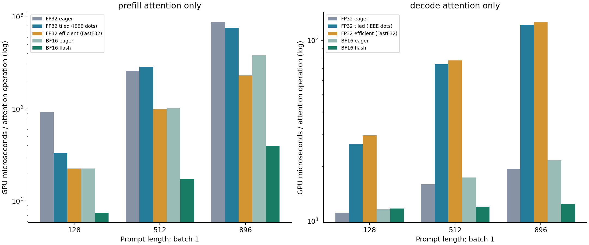
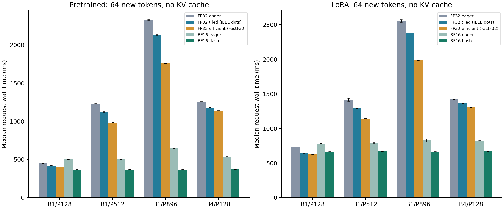
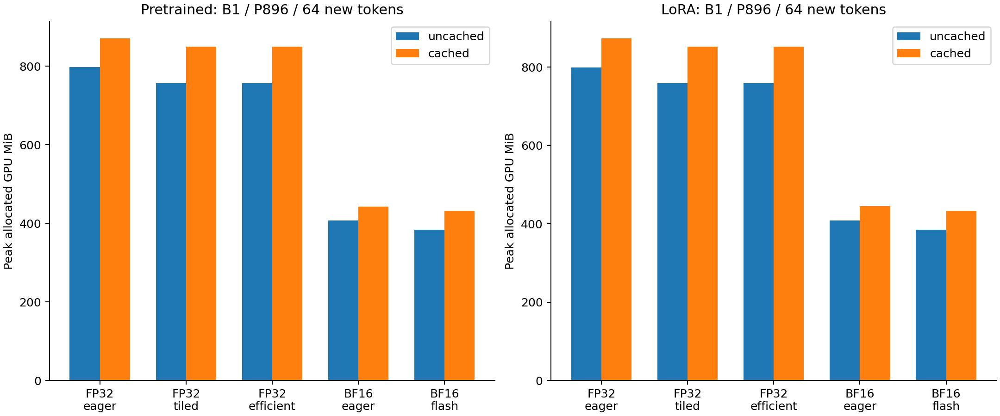

# FP32 tiled attention in minGPT

## FP32 tiled attention: measured results

**What was built**

A Triton tiled-attention inference kernel using online softmax, FP32 Q/K/V, FP32 state/output, and explicit input_precision="ieee" for BOTH matrix products. It supports causal prefill, one-token decoding, and offset multi-token KV-cache chunks. No BF16/FP16 conversions or TF32 dot products are used. Approximate GPU FP32 exponential and changed reduction order mean outputs need not be bitwise identical.

**Measured findings**

At batch 1 / prompt 896 / 64 generated tokens, pretrained FP32 eager takes 2329.8 ms; custom FP32 tiled attention takes 2134.0 ms (1.09x). With caching already enabled, that ratio is 1.01x.
The same-GPU precision bridge at this shape gives 3.60x for FP32 eager to BF16 eager, 1.75x for BF16 eager to BF16 flash, and 6.31x for the combined change.
The custom FP32 model's max logit difference from FP32 eager is 0.000534; its implementation avoids the full score matrix but is an untuned inference prototype. It matched FP32 eager tokens through EOS on 480/480 comparisons across both checkpoints and cache settings.

**Hardware and protocol**

A100 attempts produced no measurements: the first allocation raced cancellation; a follow-up remained pending with a roughly two-hour estimate. Main job 2414225 ran on NVIDIA A30 / gpu-4-23.int.turing.wpi.edu. PyTorch 2.14.0+cu130, CUDA 13.0, Triton 3.8.0. Started 2026-10-26T22:47:00Z. 3 warmups and 7 measured repetitions. TF32 flags disabled and NVIDIA_TF32_OVERRIDE=0. One resident model gives direct allocation peaks. PyTorch uses one CPU intra-op thread within a four-CPU allocation.

**Scope**

Real pretrained GPT-2 and the trained seed-42 unmerged LoRA checkpoint; 120 held-out sports questions each. GPT-2 has 12 layers, width 768, 12 heads, head width 64, and a 1,024-token context. minGPT uses an untied output head. Older experiment artifacts are preserved separately.

## What FP32 means in this experiment

**Five measured variants**

| Variant | Arithmetic / inputs | Role |
| --- | --- | --- |
| FP32 eager | FP32 | Original separate matmul/mask/softmax |
| FP32 tiled | FP32 IEEE dots | Custom online-softmax prototype |
| FP32 efficient | FP32 / FastF32 | PyTorch forced efficient backend |
| BF16 eager | BF16 | Precision-change reference |
| BF16 flash | BF16 | PyTorch forced FlashAttention |

**Important finding about PyTorch efficient attention**

The installed CUDA source selects CUTLASS OpMultiplyAddFastF32 and a Tensor Core OpClass for FP32 on SM80+. That is an FP32-input memory-efficient backend with its own arithmetic, not our IEEE-dot reference. Global cuBLAS TF32 flags do not establish how this separately compiled kernel multiplies values. We keep it clearly labeled and do not claim its speedup demonstrates pure IEEE FP32 execution.

**Custom-kernel evidence**

The prototype explicitly requests IEEE dots. Compiled PTX, cubins and SASS disassembly are saved; validation requires fma.rn.f32 and rejects mma.sync and .tf32. Float64 attention references check head widths 8/64/128, odd sequence lengths, prefill, and cached chunks. Tests also cover the real fused-QKV strides, active LoRA updates, context-window rollover and unsupported backward.

**What this does not claim**

This is not the official FlashAttention-2 CUDA backend operating in FP32. It is our FP32 implementation of the tiled online-softmax algorithm. It avoids the quadratic score matrix but uses FP32 CUDA-core multiplication rather than the BF16 Tensor Core path. Forward accuracy, memory reduction and speed must be evaluated separately. The custom kernel has no backward or dropout implementation.

## Attention-only latency and interpretation

**Median microseconds per operation**

| Length | Phase | FP32 eager | FP32 tiled | Efficient | BF16 eager | BF16 flash |
| --- | --- | --- | --- | --- | --- | --- |
| 128 | prefill | 92.83 | 33.48 | 22.48 | 22.53 | 7.42 |
| 512 | prefill | 259.79 | 287.64 | 99.28 | 101.73 | 17.25 |
| 896 | prefill | 880.69 | 759.55 | 230.55 | 381.39 | 39.63 |
| 128 | decode | 11.11 | 26.68 | 29.85 | 11.62 | 11.72 |
| 512 | decode | 15.97 | 73.78 | 77.31 | 17.46 | 12.03 |
| 896 | decode | 19.51 | 121.55 | 126.41 | 21.71 | 12.44 |

**Timing method**

Synthetic identical FP32 Q/K/V values (cast only for BF16 variants), 12 heads, width 64. Decode has one query and prompt+63 keys. CUDA graph captures 20 operations; warm for at least 0.1 seconds and measure 15 replays with CUDA events, dividing by 20. Compilation, projections, MLP, output head, sampling, and cache concatenation are excluded. These graph speedups are not full-model generation speedups.

**Why decode can lose**

The prototype uses a 16-query tile even for one query and processes K/V blocks serially inside each program. Short decode workloads can pay more launch/loop overhead than eager. This is an implementation-based explanation, not a measured occupancy diagnosis. Future work would specialize one-token decoding and tune tiles; these reported measurements use the original fixed 16x32 tile.

## Pretrained: model speed, precision and KV cache

**B1 / P896 / 64 generated tokens**

| Variant | No cache ms | Cache ms | Cache gain | Cache tok/s |
| --- | --- | --- | --- | --- |
| FP32 eager | 2329.8 | 413.8 | 5.63x | 154.7 |
| FP32 tiled (IEEE dots) | 2134.0 | 411.4 | 5.19x | 155.6 |
| FP32 efficient (FastF32) | 1758.2 | 410.9 | 4.28x | 155.8 |
| BF16 eager | 647.8 | 508.1 | 1.27x | 126.0 |
| BF16 flash | 369.1 | 409.7 | 0.90x | 156.2 |

**No-cache speedup attribution at every shape**

| Batch/prompt | FP32 tiled | BF16 only | FA at BF16 | Combined |
| --- | --- | --- | --- | --- |
| 1/128 | 1.06x | 0.89x | 1.36x | 1.21x |
| 1/512 | 1.10x | 2.44x | 1.37x | 3.34x |
| 1/896 | 1.09x | 3.60x | 1.75x | 6.31x |
| 4/128 | 1.06x | 2.34x | 1.44x | 3.36x |

**Timing definitions**

FP32 tiled compares FP32 eager / custom tiled at fixed precision. BF16 only compares FP32 eager / BF16 eager. FA at BF16 compares BF16 eager / BF16 flash. Combined compares FP32 eager / BF16 flash. Cache gain is uncached / cached at fixed variant. Ratios below one mean a slowdown.

**Controls and limitations**

Same checkpoints, deterministic prompts, output count, greedy selection and final-token-only vocabulary projection. Cache order alternates each repetition. Variants run in recorded sequential blocks so only one model is resident; backend order is not interleaved and slow clock/load drift can affect ratios. Request time includes prefill, sampling and all 64 steps, excludes cleanup, compilation, loading, tokenization, transfers and warmups. Seven repetitions characterize short-term variation, not cross-device uncertainty.

## LoRA: model speed, precision and KV cache

**B1 / P896 / 64 generated tokens**

| Variant | No cache ms | Cache ms | Cache gain | Cache tok/s |
| --- | --- | --- | --- | --- |
| FP32 eager | 2557.4 | 757.8 | 3.37x | 84.5 |
| FP32 tiled (IEEE dots) | 2382.6 | 673.3 | 3.54x | 95.1 |
| FP32 efficient (FastF32) | 1984.7 | 670.8 | 2.96x | 95.4 |
| BF16 eager | 828.1 | 761.8 | 1.09x | 84.0 |
| BF16 flash | 662.7 | 667.1 | 0.99x | 95.9 |

**No-cache speedup attribution at every shape**

| Batch/prompt | FP32 tiled | BF16 only | FA at BF16 | Combined |
| --- | --- | --- | --- | --- |
| 1/128 | 1.14x | 0.94x | 1.18x | 1.11x |
| 1/512 | 1.10x | 1.78x | 1.18x | 2.11x |
| 1/896 | 1.07x | 3.09x | 1.25x | 3.86x |
| 4/128 | 1.04x | 1.73x | 1.23x | 2.12x |

**Timing definitions**

FP32 tiled compares FP32 eager / custom tiled at fixed precision. BF16 only compares FP32 eager / BF16 eager. FA at BF16 compares BF16 eager / BF16 flash. Combined compares FP32 eager / BF16 flash. Cache gain is uncached / cached at fixed variant. Ratios below one mean a slowdown.

**Controls and limitations**

Same checkpoints, deterministic prompts, output count, greedy selection and final-token-only vocabulary projection. Cache order alternates each repetition. Variants run in recorded sequential blocks so only one model is resident; backend order is not interleaved and slow clock/load drift can affect ratios. Request time includes prefill, sampling and all 64 steps, excludes cleanup, compilation, loading, tokenization, transfers and warmups. Seven repetitions characterize short-term variation, not cross-device uncertainty.

## Memory and cache accounting

**B1 / P896: peak allocated MiB and final KV MiB**

| Model | Variant | No cache | Cache | KV |
| --- | --- | --- | --- | --- |
| pretrained | fp32_eager | 797.8 | 871.7 | 67.4 |
| pretrained | fp32_tiled | 757.5 | 850.4 | 67.4 |
| pretrained | efficient | 756.8 | 850.4 | 67.4 |
| pretrained | bf16_eager | 407.6 | 443.1 | 33.7 |
| pretrained | bf16_flash | 383.8 | 432.6 | 33.7 |
| lora | fp32_eager | 799.7 | 874.0 | 67.4 |
| lora | fp32_tiled | 759.4 | 852.7 | 67.4 |
| lora | efficient | 759.0 | 852.7 | 67.4 |
| lora | bf16_eager | 408.7 | 444.5 | 33.7 |
| lora | bf16_flash | 384.9 | 433.8 | 33.7 |

**What is counted**

Live PyTorch tensors including weights, legacy causal-mask buffers, inputs, logits, activations and caches. Reserved memory and baseline allocations are retained in raw JSON; reserved and allocated must not be added. Triton compiler CPU memory and driver/device overhead are outside this allocator metric. No other model is resident. Legacy causal-mask buffers remain allocated in every backend; tiled attention masks arithmetically and does not use them.

**Interpretation**

BF16 changes weights, activations and KV element width. FP32 tiled versus FP32 eager isolates the algorithm/implementation change without halving tensor element size. FP32 cache bytes are twice BF16 for the same shape. Dynamic cache concatenation may keep old and new allocations alive temporarily. Final cache length is prompt+63; all cases stay within the 1,024-token context.

## Training controls: prototype has no backward

**Forward + backward + AdamW, batch 2**

| Method | Length | Variant | Step ms | Peak MiB |
| --- | --- | --- | --- | --- |
| full | 512 | fp32_eager | 138.3 | 4049 |
| full | 512 | efficient | 123.0 | 3758 |
| full | 512 | bf16_eager | 66.1 | 3995 |
| full | 512 | bf16_flash | 56.3 | 3562 |
| full | 896 | fp32_eager | 245.4 | 6001 |
| full | 896 | efficient | 203.4 | 5125 |
| full | 896 | bf16_eager | 99.7 | 5883 |
| full | 896 | bf16_flash | 68.2 | 4569 |
| lora | 512 | fp32_eager | 100.3 | 2785 |
| lora | 512 | efficient | 85.3 | 2495 |
| lora | 512 | bf16_eager | 61.4 | 2725 |
| lora | 512 | bf16_flash | 52.7 | 2296 |
| lora | 896 | fp32_eager | 190.7 | 4774 |
| lora | 896 | efficient | 148.8 | 3903 |
| lora | 896 | bf16_eager | 84.0 | 4642 |
| lora | 896 | bf16_flash | 54.2 | 3343 |

**What these rows mean**

FP32 eager and efficient use FP32 parameters and FP32 inputs; efficient retains the FastF32 caveat. BF16 rows use FP32 master parameters/AdamW states and BF16 autocast. Full starts from pretrained GPT-2; LoRA starts from the selected adapter. Each kernel starts fresh with the same seed and the same synthetic batch, including across full/LoRA at a fixed length. Disable dropout; lr 1e-5, three warmups and seven measured updates.

**Custom FP32 limit**

There is no tiled_fp32 training row. The prototype explicitly raises when gradients are requested; it does not silently substitute eager backward. These diagnostic updates measure cost, not convergence, time-to-quality, or newly trained task accuracy. The learned checkpoints used for inference are not overwritten.

## Pretrained: correctness and held-out answers

**120 questions; compare tokens to FP32 eager uncached**

| Variant | Cache | Primary | Fields | Same EOS |
| --- | --- | --- | --- | --- |
| fp32_eager | uncached | 25.8% | 0.0% | 120/120 |
| fp32_eager | cached | 25.8% | 0.0% | 120/120 |
| fp32_tiled | uncached | 25.8% | 0.0% | 120/120 |
| fp32_tiled | cached | 25.8% | 0.0% | 120/120 |
| efficient | uncached | 25.8% | 0.0% | 120/120 |
| efficient | cached | 25.8% | 0.0% | 120/120 |
| bf16_eager | uncached | 22.5% | 3.3% | 19/120 |
| bf16_eager | cached | 21.7% | 4.2% | 25/120 |
| bf16_flash | uncached | 23.3% | 4.2% | 22/120 |
| bf16_flash | cached | 21.7% | 4.2% | 23/120 |

**Real-model logits versus FP32 eager**

| Variant | Max error | Cache error | Argmax agree |
| --- | --- | --- | --- |
| fp32_eager | 0.000000 | 0.000175 | 100.0% |
| fp32_tiled | 0.000534 | 0.000626 | 100.0% |
| efficient | 0.000381 | 0.000229 | 100.0% |
| bf16_eager | 2.535507 | 5.000000 | 78.4% |
| bf16_flash | 1.716431 | 3.000000 | 78.4% |

**Meaning**

FP32 logit and chunked-cache checks use combined atol=rtol=0.0003. Direct kernel tests also compare against float64. BF16 differences are measured, not asserted identical. Primary and Fields use the existing transparent sports scoring, not a broad language-quality metric. Small rounding differences can change greedy continuation. All 2,400 per-question outputs and comparisons are retained; inference parameter hashes match before/after for every variant.

## LoRA: correctness and held-out answers

**120 questions; compare tokens to FP32 eager uncached**

| Variant | Cache | Primary | Fields | Same EOS |
| --- | --- | --- | --- | --- |
| fp32_eager | uncached | 80.8% | 79.2% | 120/120 |
| fp32_eager | cached | 80.8% | 79.2% | 120/120 |
| fp32_tiled | uncached | 80.8% | 79.2% | 120/120 |
| fp32_tiled | cached | 80.8% | 79.2% | 120/120 |
| efficient | uncached | 80.8% | 79.2% | 120/120 |
| efficient | cached | 80.8% | 79.2% | 120/120 |
| bf16_eager | uncached | 80.0% | 78.3% | 119/120 |
| bf16_eager | cached | 80.0% | 78.3% | 119/120 |
| bf16_flash | uncached | 80.0% | 78.3% | 119/120 |
| bf16_flash | cached | 80.0% | 78.3% | 119/120 |

**Real-model logits versus FP32 eager**

| Variant | Max error | Cache error | Argmax agree |
| --- | --- | --- | --- |
| fp32_eager | 0.000000 | 0.000183 | 100.0% |
| fp32_tiled | 0.000107 | 0.000175 | 100.0% |
| efficient | 0.000084 | 0.000206 | 100.0% |
| bf16_eager | 1.170456 | 1.000000 | 87.8% |
| bf16_flash | 1.064049 | 1.000000 | 89.2% |

**Meaning**

FP32 logit and chunked-cache checks use combined atol=rtol=0.0003. Direct kernel tests also compare against float64. BF16 differences are measured, not asserted identical. Primary and Fields use the existing transparent sports scoring, not a broad language-quality metric. Small rounding differences can change greedy continuation. All 2,400 per-question outputs and comparisons are retained; inference parameter hashes match before/after for every variant.

## Evidence, limitations and reproduction

**GPU validation**

7-test attention validation suite passed on the GPU worker; no failures/errors, 0 skipped. The custom PTX assertions and binary FFMA/Tensor-Core instruction audit passed for prefill/decode. Installed efficient-kernel sources document FastF32 selection. CUDA traces, PTX, cubins and disassembly are retained.

**Performance limits**

One A30 allocation, sequential backend blocks, fixed tiles and limited repetitions. Attention-only graphs reduce host dispatch but are not used in actual generation. A forward FP32 prototype can save attention intermediate storage and still lose performance, especially on decode. No A100 measurements were collected. An optimized implementation would need tile tuning, specialized decode and a tested backward kernel.

**Precision limits**

IEEE here describes FP32 multiplication/accumulation in the custom matrix products, verified in PTX. Online softmax uses standard GPU FP32 approximate exponentials; reduction order differs from eager. This does not promise bitwise equality or perfectly rounded transcendental functions. PyTorch efficient remains labeled FastF32 and must not be grouped with the IEEE-dot result.

**Reproduction**

From the minGPT root: sbatch experiments/fp32_attention/run_gpu.sh. Then run python experiments/fp32_attention/build_report.py in an environment with Matplotlib and NumPy. The runner refuses to overwrite existing report.json. Source snapshots, hashes and the five-variant order are retained. Older experiment results remain untouched.

**Artifacts**

FP32_ATTENTION_REPORT.pdf; RESULTS.md; standalone RESULTS.html; METRICS.csv; ALL_OUTPUTS.csv; raw report.json plus per-variant samples; compiler PTX/cubins and CUDA traces. The selected kernel is model.set_attention_backend("tiled_fp32"); use eval() and inference_mode(). The built-in alternative is "efficient", with the FastF32 caveat.
