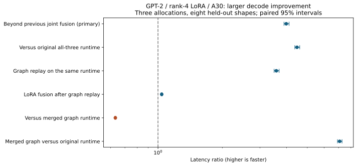

# Larger minGPT speedup: graph replay + joint LoRA/KV/attention decoding

The combined runtime is **4.474x faster than the original all-three path** and **3.985x faster than the previous fusion candidate**, on the declared held-out workloads. The main additional gain comes from established CUDA graph replay; publication novelty is not established.

Three fresh A30 allocations, eight held-out shapes, ten paired measured blocks per shape; three warmup blocks excluded. Ratio = comparison latency / candidate latency. Hierarchical 95% intervals resample allocations and paired blocks.

| Comparison | Wall speedup | 95% interval | CUDA-event ratio |
|---|---:|---:|---:|
| beyond_previous_fusion | 3.9850x | 3.8882–4.1079x | 3.9858x |
| versus_original | 4.4741x | 4.3687–4.6076x | 4.4750x |
| graph_replay_isolated | 3.5816x | 3.4952–3.6891x | 3.5822x |
| fusion_after_graphing | 1.0407x | 1.0343–1.0466x | 1.0407x |
| versus_merged_graph | 0.6314x | 0.6280–0.6349x | 0.6313x |
| merged_graph_versus_original | 7.0858x | 6.9212–7.2700x | 7.0883x |

The declared larger-gain criterion (primary interval wholly above 2x) passed.

## Every held-out workload

| Batch / prompt / output | Original ms | Previous fusion ms | Eager fixed-buffer ms | Graph ordinary LoRA ms | Graph joint fusion ms | Merged graph ms |
|---|---:|---:|---:|---:|---:|---:|
| 1 / 128 / 32 | 257.31 | 231.51 | 209.08 | 62.55 | 60.52 | 36.11 |
| 1 / 128 / 128 | 1024.51 | 910.88 | 822.52 | 229.71 | 221.35 | 132.35 |
| 1 / 512 / 32 | 261.14 | 232.15 | 207.35 | 65.75 | 63.77 | 39.29 |
| 1 / 512 / 128 | 1036.00 | 917.11 | 816.93 | 242.22 | 233.87 | 144.72 |
| 4 / 128 / 32 | 280.14 | 251.29 | 226.67 | 62.91 | 60.54 | 38.24 |
| 4 / 128 / 128 | 1120.47 | 999.62 | 900.27 | 231.17 | 221.16 | 140.71 |
| 4 / 512 / 32 | 284.45 | 252.58 | 227.83 | 70.67 | 68.22 | 45.57 |
| 4 / 512 / 128 | 1138.94 | 1003.61 | 903.96 | 249.75 | 239.72 | 158.86 |

## Setup and memory

Request times above include prefill, cache reset/copy, decode and output accumulation. They exclude graph construction and model load. Observed setup includes buffer allocation, warmup and capture with an already populated Triton disk cache; it is not clean-machine cold start.

| Batch | Joint graph setup ms | Joint runtime incremental resident MiB | Total comparison resident MiB |
|---|---:|---:|---:|
| 1 | 28.34 | 45.23 | 1683.02 |
| 4 | 31.90 | 152.54 | 1683.02 |

The total comparison footprint includes both model variants and every control runner. It is not the footprint of deploying only one runner. Incremental request peaks are in TIMINGS.csv; persistent cache and graph allocations are not zero-cost.

| Batch / prompt / output | Joint graph: first request including setup ms | At 10 requests ms/request | At 100 requests ms/request | Break-even vs previous fusion |
|---|---:|---:|---:|---:|
| 1 / 128 / 32 | 88.85 | 63.35 | 60.80 | 1 |
| 1 / 128 / 128 | 249.68 | 224.18 | 221.63 | 1 |
| 1 / 512 / 32 | 92.10 | 66.60 | 64.05 | 1 |
| 1 / 512 / 128 | 262.21 | 236.70 | 234.15 | 1 |
| 4 / 128 / 32 | 92.44 | 63.73 | 60.86 | 1 |
| 4 / 128 / 128 | 253.06 | 224.35 | 221.48 | 1 |
| 4 / 512 / 32 | 100.12 | 71.41 | 68.54 | 1 |
| 4 / 512 / 128 | 271.62 | 242.91 | 240.03 | 1 |

## Numerical and fresh-task checks

All teacher-forced, first/last-position and stale-cache checks passed. Eager and graph logits for the same kernel were bitwise equal in the declared checks. Weights were unchanged. Unsupported batch/context shapes were rejected.

| Runtime | Teacher-forced cases | Max error vs original Flash | Argmax disagreements |
|---|---:|---:|---:|
| eager_plain | 48 | 0.15625 | 0 |
| graph_plain | 48 | 0.15625 | 0 |
| eager_fused | 48 | 0.125 | 0 |
| graph_fused | 48 | 0.125 | 0 |
| merged_graph | 48 | 0.1875 | 1 |

The four-token instrumented traces retain approximately the same GPU kernel count. Eager fixed-buffer execution issued 1,517 CUDA kernel launch API calls; graph execution issued 371 plus three graph launches. Those remaining individual launches include prefill. This supports launch consolidation rather than reduced model depth. Profiler timing itself perturbs execution and is not used in request-latency estimates.

Fresh supplementary data: 360 questions, 120 independent generated matches. Familiar names/templates with new score quadruples; one trained adapter.

| Runtime | Exact reference accuracy | Field accuracy | Answer-token NLL |
|---|---:|---:|---:|
| original | 46.39% | 46.39% | 0.079922 |
| previous_fusion | 46.39% | 46.39% | 0.079920 |
| graph_fused | 46.39% | 46.39% | 0.079920 |

previous_fusion: decoded answer agreement 360/360; raw sequence agreement 243/360; absolute NLL difference 2.15562e-06; <=0.01 gate passed: True. Accuracy difference +0.000000, match-cluster 95% interval [0.0, 0.0].

For previous_fusion, no match showed decoded-answer discordance. The one-sided 95% upper bound on match discordance probability is 2.47%. A zero-width accuracy bootstrap is not proof of population equality.

graph_fused: decoded answer agreement 360/360; raw sequence agreement 243/360; absolute NLL difference 2.15562e-06; <=0.01 gate passed: True. Accuracy difference +0.000000, match-cluster 95% interval [0.0, 0.0].

For graph_fused, no match showed decoded-answer discordance. The one-sided 95% upper bound on match discordance probability is 2.47%. A zero-width accuracy bootstrap is not proof of population equality.

## Interpretation and limits

Graph replay accounts for the large improvement; the graph_plain/graph_fused contrast separately quantifies the smaller LoRA-fusion increment after replay. Merged graph serving is a strong control and should be preferred when its deployment tradeoffs fit. Its task-level quality was not assessed in the fresh three-mode task check, though its numerical gates passed.

Three timing allocations used 2 physical A30 GPUs; their intervals do not establish a GPU-family population effect. Native FP16, one model/rank, no fixed clocks, no concurrent serving or adapter changes. Official PyTorch FlashAttention is used for prefill; custom online-softmax decoding is not official FA1/FA2. Graph execution and LoRA graph serving are prior art. This is a measured improvement in this repository, not a state-of-the-art or established-novelty claim.

Total discovery/confirmation/quality allocation: 22.27 GPU-minutes across five jobs. Model loading, warmups, graph capture and validation are included in allocation time.

See RESEARCH.md, CONFIRMATION_PROTOCOL.md, SUMMARY.json, TIMINGS.csv, AMORTIZATION.csv and results/ for the complete design, source hashes, raw timings, outputs and traces.
