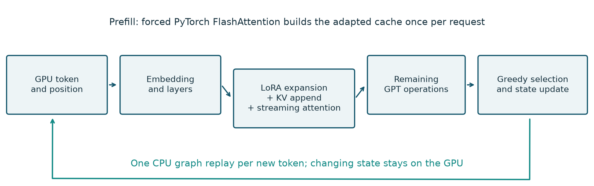
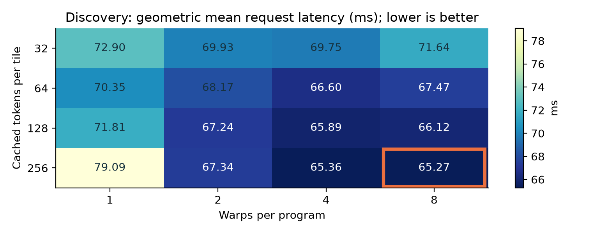
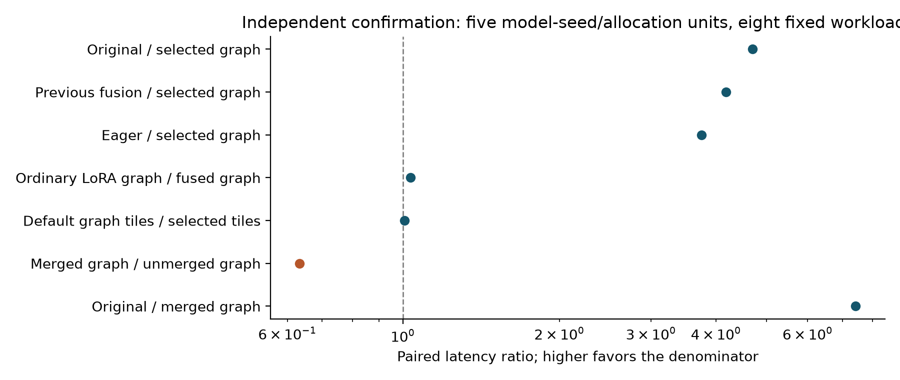

# Graph-Compatible Joint Decoding for minGPT

Methodology, validation-selected hyperparameters, speedups and answer quality | November 10, 2026

This report evaluates a reusable CUDA graph runtime that combines an unmerged LoRA adapter, a full KV cache, and fused streaming attention. Using the previously selected rank-2 model setting and a newly selected decoder launch configuration, the runtime achieved 4.695x speedup over the same trained model using dynamic-cache forced FlashAttention (95% interval 4.667–4.720x). It achieved 4.182x over the preceding Python fusion runtime (4.159–4.206x).

The primary comparison holds model weights fixed. Graph replay reduces repeated CPU launch overhead; fusion removes a smaller intermediate-computation boundary. The report uses “best tested under the declared objective,” not global optimality. The earlier 4.474x result used a different rank-4 checkpoint and is kept separate.

| Selected component | Setting | Evidence |
| --- | --- | --- |
| LoRA rank / alpha | 2 / 8 (scale = 4) | Inherited validation-based 45-setting study |
| Training learning rate | 0.001, constant | Inherited selected training configuration |
| Cache / prefill | 1,024 positions / one full prefill | Full-context cache; no truncation or eviction |
| Decode history tile | 256 | New 16-configuration runtime search |
| Decode program warps | 8 | Selected jointly with tile size |
| Serving precision | Native FP16; TF32 disabled | Identical policy in every new runtime comparison |

Fresh exact-reference accuracy averaged 100.00% for the original runtime and 100.00% for the selected graph runtime. These results use five trained seeds and 360 fresh questions from 120 match groups. Better checkpoint quality relative to the old exploratory model is not an accuracy gain caused by graph replay.

## 1. What the implementation changes

| Architecture / adaptation | Setting |
| --- | --- |
| Blocks / heads / embedding / head width | 12 / 12 / 768 / 64 |
| Vocabulary / learned context | 50,257 / 1,024 |
| LoRA targets / trainable parameters | QKV, attention output and both MLP projections in all blocks; 294,912 parameters across 48 adapted projections |

Prefill processes the prompt with forced PyTorch FlashAttention, then copies each layer’s adapted keys and values into a fixed-capacity buffer. The first generated token comes from the final prompt logit. Subsequent tokens use one captured GPU decoding step per token.

The original Python path concatenates new K/V tensors onto the history and launches many small operations for every token. The graph-compatible path retains stable addresses for cache buffers, current token, current learned position, output buffer and write index. Those tensor values change on the GPU while their shapes and addresses remain compatible with replay.

| Stage | Operation | Why it helps |
| --- | --- | --- |
| Static KV storage | Write new adapted K/V into the next slot | Avoid repeatedly copying the entire history |
| Device-resident position | Attention loads the live valid length | Growing context does not require a new graph |
| Joint QKV fusion | Expand LoRA, append K/V and attend in one kernel | Remove expanded-update tensors and separate launches |
| Streaming attention | Read valid K/V tiles with online softmax | Avoid an attention-probability matrix |
| Full-step graph replay | Replay embeddings, layers, sampler and state updates | Consolidate repeated CPU submission work |

For one projection, y = W0 x + (alpha/r) B(Ax). The base projection and z = Ax remain outside the fused attention kernel. Inside it, each head forms q = q0 + (alpha/r) Bq z, k = k0 + (alpha/r) Bk z and v = v0 + (alpha/r) Bv z. It writes adapted K/V and consumes current values immediately. The three other LoRA projections per block remain ordinary operations inside the graph. [1]

Online softmax maintains a running maximum, normalization sum and weighted value sum as it visits cache tiles. Historical K/V remain fully adapter-specific; they are not approximated by a different adapter’s or base model’s cache. The valid history is read according to the device position; unused capacity is not treated as real context. [2]

Example: after a 128-token prompt, prefill predicts the first answer token and leaves 128 cached inputs. The first replay processes that token at position 128 and predicts the second; the cache then contains 129 inputs. The next replay advances the position to 130 and the cache to 130 inputs.

A 128-token answer uses one prefill and 127 one-token replays. A graph records operations and dependencies, not a fixed answer. Different prompts still produce different outputs. The decode kernel is an experimental FlashAttention-style implementation, not the official FA1 or FA2 decode implementation. Official PyTorch FlashAttention handles prefill. Graph replay and its stable-address requirements follow established CUDA/PyTorch mechanisms. [3,4]

## 2. How the hyperparameters were selected

The inherited study searched 45 training settings: rank {2,4,8,16,32}, alpha/rank {1,2,4}, and learning rate {0.0001,0.0003,0.001}. Every setting used seeds 11,22,33, yielding 135 discovery training runs. Each run received 2,400 successful updates, batch 8, sequence length 128, AdamW with zero weight decay, clipping at norm 1 and zero dropout. Validation occurred every 300 updates; the lowest validation NLL selected a checkpoint.

The operational objective selected the lowest mean warm training-step latency among settings whose mean validation NLL was within 0.01 of the quality-best setting. It selected rank 2 / alpha 8 / LR 0.001. The validation-quality-best setting was rank 32 / alpha 64 / LR 0.0003. These are different objectives. Five new seeds (101,202,303,404,505) were independently trained after selection; their completed checkpoint metadata and hashes were verified here. Learning rate affects the trained checkpoint; it is not an inference-time launch parameter. Rank and alpha also determine the stored adapter shape and serving scale.

The inherited cache sweep selected chunk 1024, which means one full prefill for these workloads. Its FA1-derived prototype selected query/key tiles 64/128 and four warps. That query tile does not transfer to a one-query decode kernel. This report therefore inherited the trained adapter/cache choice but ran a new decoder-specific search.

The new search crossed history tiles {32,64,128,256} with warps {1,2,4,8}. Three fresh A30 allocations used discovery checkpoints 11/22/33. Each measured batch {1,4}, prompt {32,896}, output 32, with two warmups and five shuffled paired blocks. Every configuration had to pass the declared numerical gates in all allocations. Selection minimized equally weighted geometric mean per-workload median wall latency.

The selected configuration was tile 256 / 8 warps, with discovery score 65.267 ms. The original 128/4 control scored 65.891 ms. All 16 configurations passed. selection.json was hashed before confirmation; fresh test answers did not select any setting. The finite grid has boundaries: a winner at tile 256 and/or eight warps does not prove that a larger untested setting would be worse. Separating discovery and confirmation addresses selection-bias concerns. [5]

## 3. Controlled confirmation methodology

| Design element | Specification |
| --- | --- |
| Hardware | Five new A30 allocations; physical GPU UUIDs retained |
| Model units | Five independently trained selected-setting seeds; one allocation per seed |
| Held-out shapes | Batch {1,4} × prompt {128,512} × output {32,128}: eight shapes |
| Repetitions | Three warmup blocks excluded; ten measured paired blocks per shape |
| Pairing | Same fresh synthetic prompt across modes; shuffled order within block |
| Sampling / context | Fixed output count; greedy softmax/topk; prompt + output ≤ 1024 |
| Precision | Same native-FP16 weights; TF32 off; eval/inference mode |
| Timers | Synchronized host wall time; CUDA-event time also recorded |
| Included costs | Prefill, initial cache copy/reset, decode and output assembly |
| Excluded costs | Model load, graph construction/capture, compilation, host IO and mode installation |
| Memory controls | Same resident model/control set throughout paired comparisons |
| Uncertainty | 5,000 paired bootstrap draws over seed/allocation units and blocks; shapes fixed |

Primary estimand: exp(mean(log(original latency / selected-graph latency))), equally weighting the eight shapes and five units. The five units combine training-seed and allocation effects; one allocation per seed cannot disentangle those variance components. Workload shapes are a fixed design rather than independently sampled tasks. Secondary intervals are descriptive and not adjusted for multiple comparisons.

| Control | Purpose |
| --- | --- |
| Original dynamic-cache forced Flash | Matched trained-model deployment reference |
| Previous Python joint fusion | Progress beyond the first fusion implementation |
| Eager fixed-buffer fused runtime | Isolate graph replay on identical runtime mathematics |
| Ordinary-LoRA graph, selected tiles | Isolate LoRA fusion after graph replay |
| Fused graph, original 128/4 tiles | Isolate the new launch-parameter tuning |
| Fused graph, selected tiles | Candidate |
| Merged-LoRA graph, selected tiles | Strong fixed-adapter serving control |

No isolated speedups are multiplied. All ratios come from directly measured matched modes. Synthetic timing prompts control shape and length; fresh task prompts separately assess answer quality. No prior rank-4 timing samples or old test answers enter these estimates.

## 4. Measured speedups

| Comparison | Speedup | 95% interval |
| --- | --- | --- |
| Original / selected graph | 4.695x | 4.667–4.720x |
| Previous fusion / selected graph | 4.182x | 4.159–4.206x |
| Eager / selected graph | 3.754x | 3.731–3.774x |
| Ordinary-LoRA graph / fused graph | 1.035x | 1.030–1.041x |
| Original-tile graph / selected-tile graph | 1.006x | 1.002–1.011x |
| Merged graph / unmerged graph | 0.633x | 0.630–0.636x |
| Original / merged graph | 7.415x | 7.363–7.466x |

| Batch / prompt / output | Original ms | Selected graph ms | Merged graph ms |
| --- | --- | --- | --- |
| 1 / 128 / 32 | 265.82 | 59.48 | 36.09 |
| 1 / 128 / 128 | 1059.30 | 215.44 | 130.68 |
| 1 / 512 / 32 | 271.05 | 62.28 | 38.94 |
| 1 / 512 / 128 | 1078.57 | 226.35 | 141.80 |
| 4 / 128 / 32 | 293.09 | 60.38 | 38.30 |
| 4 / 128 / 128 | 1155.79 | 218.96 | 139.57 |
| 4 / 512 / 32 | 293.85 | 67.46 | 45.33 |
| 4 / 512 / 128 | 1167.76 | 236.45 | 157.20 |

The launch-tuning contrast is 1.0064x (95% interval 1.0020–1.0106x). Its interval supports a positive transfer of the discovery choice.

The selected launch setting was slower than 128/4 on 1 of eight held-out shapes. The worst tuning ratio was 0.9954x at batch 4, prompt 128, output 128. It is a weighted workload-family choice, not a per-shape optimum; all mode timings are in TIMINGS.csv.

## 5. Answer quality

A new generator seed produced 120 fresh fictional matches and 360 winner/halftime/comeback questions before runtime search. Score quadruples exclude the original sports splits, completed tuning-study splits and both preceding fresh graph/fusion sets. The task uses familiar training team names and established templates; this is within-template generalization, not a real-world language benchmark.

The same 360 questions were evaluated under all five trained model seeds: 1,800 paired model/question cases per mode, but only 120 unique match groups. Generation used equal-token-length batches of up to four, identically grouped across modes, with 64 greedy tokens. Scoring trims the first EOS and subsequent User turn. Raw token sequences are retained separately from trimmed answer agreement. Answer-token NLL includes EOS and uses cached teacher forcing. NLL differences must be ≤0.01 for every seed.

| Runtime | Mean exact accuracy | Crossed 95% interval | Mean NLL |
| --- | --- | --- | --- |
| Original | 100.00% | Degenerate bootstrap; see bound below | 0.000020 |
| Selected graph | 100.00% | Degenerate bootstrap; see bound below | 0.000020 |
| Merged graph | 100.00% | Degenerate bootstrap; see bound below | 0.000020 |

| Training seed | Original exact | Graph exact | Merged exact |
| --- | --- | --- | --- |
| 101 | 100.00% | 100.00% | 100.00% |
| 202 | 100.00% | 100.00% | 100.00% |
| 303 | 100.00% | 100.00% | 100.00% |
| 404 | 100.00% | 100.00% | 100.00% |
| 505 | 100.00% | 100.00% | 100.00% |

Selected graph: 1800/1,800 trimmed answers agreed with original; 1468/1,800 full raw sequences agreed. Mean exact-accuracy difference +0.000 percentage points; crossed 95% interval +0.000 to +0.000 points. Maximum per-seed absolute NLL difference 1.06841e-08; all NLL gates passed: True.

Merged graph: 1800/1,800 trimmed answers agreed with original; 1437/1,800 full raw sequences agreed. Mean exact-accuracy difference +0.000 percentage points; crossed 95% interval +0.000 to +0.000 points. Maximum per-seed absolute NLL difference 1.78674e-07; all NLL gates passed: True.

All observed questions were correct for the selected graph under all five fixed models. Rather than treating a 100%–100% bootstrap interval as certainty, the one-sided 95% upper bound on a fresh match having any error is 2.47%. This bound is conditional on the fixed tested models/generator; it does not cover unseen training seeds, task domains or model families.

Quality intervals jointly resample seeds and match groups, retaining related questions. Zero observed differences do not prove population equality. Accuracy differences from the old rank-4 model reflect training/checkpoint selection, not graph replay.

## 6. Setup, memory and practical deployment

| Batch | Selected setup ms | Incremental runner resident MiB |
| --- | --- | --- |
| 1 | 30.47 | 45.23 |
| 4 | 34.84 | 152.54 |

Observed setup includes allocation, warmup and graph capture with a populated on-disk compilation cache. It excludes common model loading and is not a clean-machine cold-start measurement. The comparison’s total resident allocation contains both model variants and all control runners; it is not a single-runner deployment footprint. Persistent graph/cache memory and incremental request peaks are reported separately.

| Batch / prompt / output | 1 request ms | 10 requests ms/req | 100 requests ms/req | Break-even |
| --- | --- | --- | --- | --- |
| 1 / 128 / 128 | 245.92 | 218.49 | 215.75 | 1 |
| 1 / 512 / 128 | 256.83 | 229.40 | 226.66 | 1 |
| 4 / 128 / 128 | 253.80 | 222.44 | 219.31 | 1 |
| 4 / 512 / 128 | 271.29 | 239.94 | 236.80 | 1 |

Amortized latency is (observed setup + N × median warm request latency) / N. Break-even compares this setup cost with the matched original runtime. The table shows representative 128-token generations; AMORTIZATION.csv contains all eight shapes. Real model loading, uncached compilation, tokenization and service scheduling add deployment costs not estimated by this formula.

A runner is tied to one model/adapter, batch size, rank, scale, precision and device. Prompt lengths may vary without recapture; each prompt resets its cache. The prototype has no continuous batching, concurrent requests, mixed adapters, arbitrary sampling or context rollover. Adapter replacement requires a new runner and fresh cache. Reserving a full cache costs more memory on short requests. The asymptotic attention cost remains proportional to valid history length; the improvement is scheduling and data movement, not skipped context or layers.

## Numerical checks

| Numerical runtime | Cases | Max logit error | Argmax differences |
| --- | --- | --- | --- |
| eager_fused | 80 | 0.125 | 1 |
| plain_graph | 80 | 0.125 | 1 |
| default_graph | 80 | 0.125 | 1 |
| selected_graph | 80 | 0.125 | 1 |
| merged_graph | 80 | 0.1875 | 1 |

Logit gates use atol=0.1 and rtol=0.02, so a maximum absolute error above 0.1 can still pass for sufficiently large reference logits. Eager and graph execution of the same selected fused kernel were checked for bitwise-equal logits. First/last cache positions, stale-prompt isolation and rejection of overflow/batch mismatch passed. Model parameter hashes were unchanged by inference.

## 7. Scope, prior art and reproducibility

| Evidence source | What it establishes | What it does not establish |
| --- | --- | --- |
| Inherited 45-setting study | Operational training/cache settings under a declared quality/cost objective | Global optimality or decoder-kernel optimality |
| Earlier rank-4 graph experiment | 4.474x repository improvement for that model/workload family | Performance of the new rank-2 model |
| New 16-setting runtime search | Best discovery launch choice among the tested configurations | Best possible tile/warp policy on every workload |
| New matched five-seed confirmation | Runtime/quality behavior with selected checkpoints and fresh data | Cross-model/task/GPU serving superiority |

CUDA graph replay, graph-compatible LoRA execution, online-softmax attention and adapter/cache management have prior art. The narrow contribution is a reproducible implementation/evaluation of current-token LoRA expansion, full-cache append and streaming attention inside a graph-compatible GPT-2 decode step. This report does not establish publication novelty. Production fused-KV FlashAttention, production multi-adapter graph engines, additional models/ranks and GPU families remain missing external-validity comparisons. [6,7]

The five confirmation allocations used 2 physical A30 GPUs. GPU clocks were not fixed, and comprehensive co-tenant isolation was not imposed. Paired shuffled modes reduce timing-state effects but do not remove them. One allocation per seed means seed and allocation uncertainty cannot be separated. The fresh quality set is synthetic and has only 120 independent match groups. Native-FP16 serving differs from the inherited study’s FP32-weight/autocast policy.

New search plus confirmation/quality allocation time: 35.88 GPU-minutes across eight jobs. This includes loading, compilation, capture and validation. No new training was performed. The inherited study’s 135 discovery runs used 324,000 successful updates; its selected/control confirmation used another 24,000 updates. Those training costs are separate from deployment speedups.

| Reproducibility artifact | Contents |
| --- | --- |
| PROTOCOL.md / manifest.json | Predeclared design, inherited selection hash and frozen fresh-data hash |
| selection.json / selection.sha256 | All runtime candidates and discovery-only winner |
| SUMMARY.json / TIMINGS.csv | Paired estimands, intervals and per-workload timings |
| AMORTIZATION.csv / ACCOUNTING.txt | Setup assumptions and Slurm allocation costs |
| results/*.json and logs | Checkpoint/source hashes, raw outputs, timings, quality and failure evidence |
| source/ and ARTIFACT_SHA256.json | Archived executable sources and content hashes |

Reproduction requires the existing cached GPT-2 base/tokenizer and trained adapter checkpoints whose hashes are recorded. The report package retains sources and raw evidence but does not duplicate large pretrained weights. Prior production model files and earlier study outputs are preserved.

## References and runtime-search appendix

[1] Hu et al.. LoRA: Low-Rank Adaptation of Large Language Models. [Source](https://arxiv.org/abs/2106.09685)

[2] Dao et al.. FlashAttention: Fast and Memory-Efficient Exact Attention with IO-Awareness. [Source](https://arxiv.org/abs/2205.14135)

[3] PyTorch. CUDA semantics: CUDA graphs. [Source](https://docs.pytorch.org/docs/stable/notes/cuda)

[4] NVIDIA. CUDA Programming Guide: CUDA Graphs. [Source](https://docs.nvidia.com/cuda/cuda-programming-guide/04-special-topics/cuda-graphs.html)

[5] Cawley and Talbot. On Over-fitting in Model Selection and Subsequent Selection Bias in Performance Evaluation. [Source](https://jmlr.org/papers/v11/cawley10a.html)

[6] Jeon et al.. LRAgent: Efficient KV Cache Sharing for Multi-LoRA LLM Agents. [Source](https://arxiv.org/abs/2602.01053)

[7] Tran and Yu. EpiLoRA: Fusing Many LoRA Adapters into Low-Precision GEMMs for Serving and RL. [Source](https://arxiv.org/abs/2611.03899)

## Complete tested decoder grid

| History tile | Warps | Numerical gates | Discovery score ms |
| --- | --- | --- | --- |
| 32 | 1 | Passed | 72.902 |
| 32 | 2 | Passed | 69.927 |
| 32 | 4 | Passed | 69.745 |
| 32 | 8 | Passed | 71.644 |
| 64 | 1 | Passed | 70.351 |
| 64 | 2 | Passed | 68.172 |
| 64 | 4 | Passed | 66.598 |
| 64 | 8 | Passed | 67.474 |
| 128 | 1 | Passed | 71.813 |
| 128 | 2 | Passed | 67.241 |
| 128 | 4 | Passed | 65.891 |
| 128 | 8 | Passed | 66.120 |
| 256 | 1 | Passed | 79.092 |
| 256 | 2 | Passed | 67.342 |
| 256 | 4 | Passed | 65.360 |
| 256 | 8 | Passed | 65.267 |

