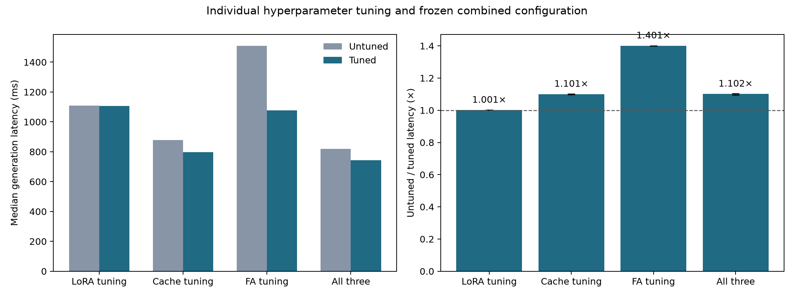

# Hyperparameter tuning results

Best tested settings, selected on validation data and tuning timings before confirmation/test evaluation. Single training seed; speed and quality claims are limited to this grid, workload, GPU, and FA1-derived prototype.

All timings use FP32 stored weights with FP16 autocast, batch 1, prompt 896, 64 generated tokens. LoRA is unmerged. Cache tuning changes prefill chunk size without evicting tokens. FA tuning changes query/key tile sizes and warp count; every FA configuration uses the FA1-derived algorithm, not the original optimized FA1 CUDA library.

Selected LoRA: `{'rank': 2, 'alpha': 4, 'lr': 0.001}`. Selected cache prefill chunk: `896`. Selected FA tiles/warps: `[32, 64, 4]`.

| Comparison | Untuned ms | Tuned ms | Speedup |
|---|---:|---:|---:|
| lora | 1107.943 | 1106.663 | 1.001× |
| cache | 878.096 | 797.850 | 1.101× |
| fa | 1510.178 | 1077.882 | 1.401× |
| combined | 819.565 | 743.967 | 1.102× |
| lora_training_step | 65.950 | 66.878 | 0.986× |

Ratios below 1 are slowdowns. The predeclared untuned controls may themselves win; we do not deliberately choose the slowest setting. LoRA inference and training speedups are reported separately. KV cache has no role in the training step.

The combined row holds all three methods enabled and compares the individual winners against rank 4 / alpha 8 / LR 0.0001, cache prefill chunk 128, and FA tiles 16×32 / 4 warps. Individual winners are not jointly reoptimized. Confirmation uses fresh prompts, seven shuffled paired repeats, and bootstrap intervals. Prompt length, batch size, output length, precision and cache retention are held fixed.

LoRA eligibility requires validation NLL within 0.02 of the best grid candidate; eligible candidates are ranked by tuning inference latency. The untuned LoRA control is reported even if it fails that quality constraint. Runtime settings must pass tensor correctness and full validation NLL checks. FP16 chunk sizes can change rounding and greedy tokens; cache settings are gated on same-input logit closeness and validation NLL, and raw token differences are preserved. Test data does not select any settings.

| Model | Validation NLL | Test fields accuracy |
|---|---:|---:|
| baseline | 0.07581 | 0.500 |
| tuned | 0.02535 | 0.825 |

Raw timing samples, token outputs, source/data hashes, frozen selections, quality scores and checkpoints are preserved beside this report. Training/search overhead is not included in inference latency. There is no claim that tuning amortizes its search cost.

## Confirmation uncertainty

Paired bootstrap 95% intervals describe timing variability within this allocation; they do not measure uncertainty across hardware or training seeds.

| Comparison | Speedup | 95% interval |
|---|---:|---:|
| lora | 1.001× | 1.001–1.002× |
| cache | 1.101× | 1.098–1.103× |
| fa | 1.401× | 1.401–1.401× |
| combined | 1.102× | 1.094–1.105× |

## All LoRA candidates

| Rank | Alpha | LR | Validation NLL | Selected step | Training ms/step | Eligible |
|---|---|---|---|---|---|---|
| 2 | 2 | 0.0001 | 0.09127 | 1200 | 66.930 | False |
| 2 | 2 | 0.001 | 0.04773 | 1200 | 64.556 | False |
| 2 | 4 | 0.0001 | 0.08631 | 1200 | 66.906 | False |
| 2 | 4 | 0.001 | 0.02527 | 1200 | 66.878 | True |
| 4 | 4 | 0.0001 | 0.08520 | 900 | 67.316 | False |
| 4 | 4 | 0.001 | 0.05190 | 1200 | 66.254 | False |
| 4 | 8 | 0.0001 | 0.07592 | 900 | 65.950 | False |
| 4 | 8 | 0.001 | 0.02801 | 1200 | 67.188 | True |

## Runtime tuning timings

These are selection timings; final speedups above use fresh confirmation measurements.

| Method | Setting | Median ms |
|---|---|---:|
| lora | {'rank': 2, 'alpha': 4, 'lr': 0.001} (eligible=True) | 1108.067 |
| lora | {'rank': 4, 'alpha': 8, 'lr': 0.0001} (eligible=False) | 1108.758 |
| lora | {'rank': 4, 'alpha': 8, 'lr': 0.001} (eligible=True) | 1108.835 |
| cache | 64 | 951.701 |
| cache | 128 | 857.125 |
| cache | 256 | 816.471 |
| cache | 896 | 777.055 |
| fa | (16, 32, 4) | 1511.592 |
| fa | (16, 32, 8) | 1563.642 |
| fa | (16, 64, 4) | 1146.654 |
| fa | (16, 64, 8) | 1247.897 |
| fa | (32, 32, 4) | 1295.980 |
| fa | (32, 32, 8) | 1432.571 |
| fa | (32, 64, 4) | 1078.616 |
| fa | (32, 64, 8) | 1123.675 |

Cache and FA sweeps and their individual confirmation comparisons hold the untuned LoRA checkpoint fixed. LoRA-only confirmation uses eager attention with caching disabled. The combined comparison changes all three selected settings together.

## Cache numerical checks and protocol amendment

The initial runtime sweep stopped on an exact greedy-token check. Before confirmation and test evaluation, the recorded protocol was amended to require same-input logit closeness and validation NLL parity; all eight training runs were reused. FP16 execution shapes affect rounding. This amendment and the observed divergence are part of the result.

| Prefill chunk | Validation NLL | Max last-prefill logit error | Greedy tokens equal full prefill |
|---|---:|---:|---|
| 64 | 0.075571 | 0.09375 | True |
| 128 | 0.075923 | 0.06250 | True |
| 256 | 0.075923 | 0.06250 | False |
| 896 | 0.075923 | 0.00000 | True |

## Held-out combined answer quality

| Configuration | Primary correct | Numbers correct | Fields correct | Exact reference |
|---|---:|---:|---:|---:|
| baseline | 0.500 | 1.000 | 0.500 | 0.500 |
| tuned | 0.825 | 1.000 | 0.825 | 0.825 |

