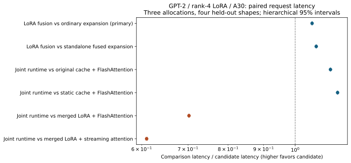

# Joint decode fusion: measured results

The current-token LoRA QKV expansion/cache-append/streaming-attention prototype is a measured implementation improvement for unmerged adapters in this minGPT setup. The combined runtime is 1.1245x faster than the original all-three path; the isolated LoRA-fusion increment is 1.0578x. Merged serving is faster still. Publication novelty is not established.

Three fresh A30 allocations; four workload shapes held out from discovery; ten paired blocks per shape and allocation. Ratios are comparison latency / candidate latency. Values above 1 favor the candidate. Intervals use the declared allocation/block bootstrap; only three allocations limit uncertainty estimation.

| Comparison | Wall speedup | 95% interval | CUDA-event ratio |
|---|---:|---:|---:|
| incremental_lora_fusion | 1.0578x | 1.0570–1.0586x | 1.0578x |
| beyond_standalone_fused_lora | 1.0725x | 1.0714–1.0738x | 1.0725x |
| versus_original_all_three | 1.1245x | 1.1238–1.1254x | 1.1245x |
| versus_static_flash | 1.1515x | 1.1502–1.1525x | 1.1515x |
| versus_merged_flash | 0.7024x | 0.7013–0.7033x | 0.7023x |
| versus_merged_stream | 0.6100x | 0.6088–0.6114x | 0.6100x |

## All held-out workloads

| Batch / prompt / output | Dynamic Flash ms | Static Flash ms | Static stream ms | Standalone expand + stream ms | Joint fused ms | Merged Flash ms | Merged stream ms |
|---|---:|---:|---:|---:|---:|---:|---:|
| 1 / 128 / 64 | 509.56 | 520.44 | 479.64 | 489.02 | 454.42 | 320.63 | 280.38 |
| 1 / 512 / 64 | 512.49 | 524.35 | 477.66 | 487.29 | 451.76 | 326.76 | 280.49 |
| 4 / 128 / 64 | 553.45 | 566.10 | 524.72 | 530.95 | 495.50 | 340.25 | 299.32 |
| 4 / 512 / 64 | 564.31 | 576.78 | 529.55 | 535.28 | 499.27 | 350.12 | 301.61 |

## Correctness and scope

Kernel gate: 120 cases; maximum absolute fused-output error 0.000488281. All configured tolerance checks passed. Model weights were unchanged.

| Model mode | Teacher-forced cases | Max logit error | Max KL | Argmax disagreements |
|---|---:|---:|---:|---:|
| dynamic_flash | 24 | 0 | 0 | 0 |
| expand_stream | 24 | 0.125 | 0.000383767 | 0 |
| fused_stream | 24 | 0.125 | 0.000371618 | 0 |
| static_flash | 24 | 0 | 0 | 0 |
| static_flash-merged | 24 | 0.1875 | 0.000485042 | 0 |
| static_stream | 24 | 0.125 | 0.000383767 | 0 |
| static_stream-merged | 24 | 0.1875 | 0.000483654 | 0 |

The prespecified primary timing endpoint passed the interval-above-1 criterion. The stronger standalone-fusion comparison also passed that criterion (secondary analysis).

These are request-level measurements with all methods enabled. They do not establish publication novelty, production superiority, task-level noninferiority, or speedup on other models/ranks/GPUs. The custom decode kernel uses tiled online softmax; it is not official FlashAttention. Official fused-KV FlashAttention and CUDA graphs remain missing controls. Merged serving is explicitly included and must determine the practical use case.

Raw outputs, per-allocation measurements, telemetry and source hashes are in results/. Version-1 discovery is retained but excluded from all confirmation estimates. See PROTOCOL.md, RESEARCH.md, SUMMARY.json and TIMINGS.csv.

## Fresh supplementary task check

180 fresh questions from 60 generated matches, one fixed trained adapter. This check uses familiar team names and established templates with new score quadruples, not a new task domain.

| Metric | Original dynamic cache + FlashAttention | Joint fused runtime |
|---|---:|---:|
| Exact reference accuracy | 54.44% | 54.44% |
| Field accuracy | 54.44% | 54.44% |
| Answer-token NLL | 0.073365 | 0.073367 |

Decoded answer agreement: 180/180. Raw 64-token sequence agreement: 137/180. Absolute NLL difference: 2.13838e-06; declared <=0.01 gate passed: True.

Paired exact-accuracy difference: +0.0000; match-cluster bootstrap interval [0.0, 0.0]. A zero-width interval from all-equal pairs is not proof of equality.

With no decoded-answer discordance, the one-sided 95% upper bound on the probability of a match having any answer discordance is 4.87%.

## Provenance and mechanism

Three timing allocations ran on 2 physical A30 GPUs across 2 nodes. Repeated allocations are not independent draws of GPU architecture. No fixed GPU clocks or comprehensive co-tenant isolation were imposed; paired shuffled order reduces, but cannot eliminate, runtime-state effects.

The four-token profiler trace includes one prefill and three decode steps. Dynamic caching used 76 `aten::cat` calls; the static runtimes used four (output token accumulation). The standalone expansion control used 36 `_expand` and 36 `_decode` calls; the joint runtime used 36 `_decode` calls with expansion inside them. This supports the launch-elimination mechanism.

The candidate is slower than both merged controls; their ratios in the table are below one. Any practical use case must justify retaining separate adapters. Standalone fused expansion is our own control kernel, not a benchmark of a production LoRA engine.

Total Slurm GPU allocation time, including discovery, confirmation and fresh quality: 910 seconds (15.17 GPU-minutes), across five completed jobs. Loading, compilation and validation are included in that allocation cost.
