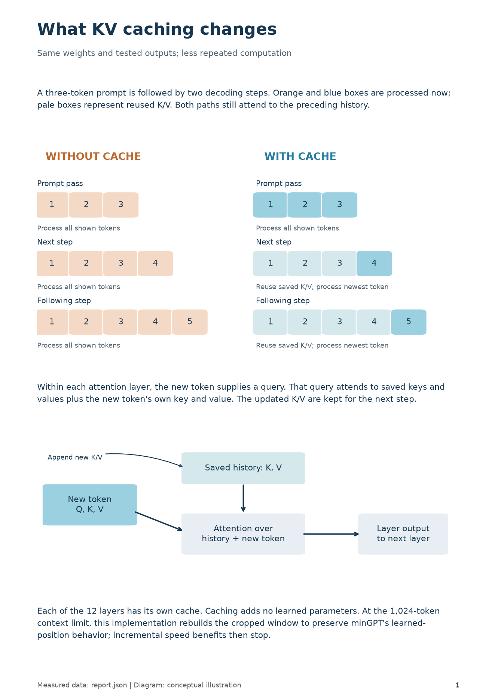
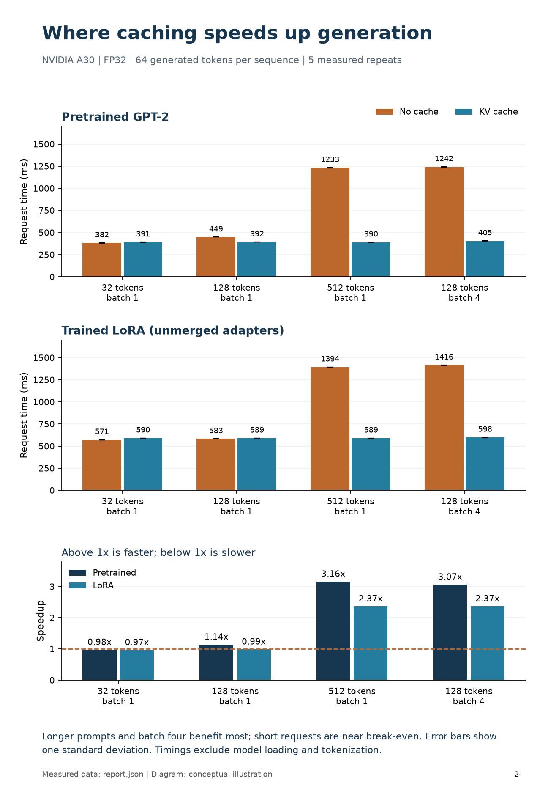
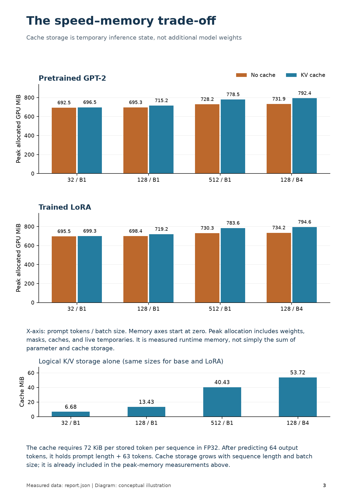

**KV caching: implementation and validation**

**Purpose**

Reduce repeated work during autoregressive generation while preserving model outputs. This is an inference optimization: no training, extra learned parameters, or weight updates are required.

**How it works in this minGPT**

The first forward pass processes the full prompt (prefill). Each of the 12 transformer layers saves its attention keys and values. Subsequent steps process only one new token; its query attends to the saved history. Cached length offsets both the causal mask and learned position embeddings. The cache grows as generation proceeds.

**Implementation**

Opt-in API: model.eval(); model.generate(ids, 64, use_cache=True). Direct forward calls accept past_key_values and return a per-layer cache. Existing training and checkpoint formats remain compatible. Both benchmark modes compute only final-position output logits, avoiding a separate output-head optimization as a confound.

**Validation on real checkpoints**

| Checkpoint | Identical outputs | Accuracy: off / on | Max logit difference |
|---|---|---|---|
| pretrained | 120/120 | 25.8% / 25.8% | 0.000320 |
| full | 120/120 | 19.2% / 19.2% | 0.000214 |
| lora | 120/120 | 80.8% / 80.8% | 0.000237 |

**Meaning of the checks**

All 40 generated token IDs matched for every one of the 120 held-out sports prompts in each checkpoint: 360/360 comparisons. These are seed-42 checkpoints; accuracy here is not a three-seed average. Chunked FP32 logits passed combined absolute/relative tolerances of 0.0002 and had identical argmax tokens. Before/after parameter hashes matched for every model.

**Additional tests**

All 18 repository tests passed, including four KV-cache tests. Coverage includes chunked decoding, nonzero LoRA adapters, batched generation, seeded sampling, context-window overflow, independent requests, normal training, and checkpoint compatibility. The CPU demo also reloads the trained adapter and compares both generation paths.

**Inference speed: measured results**

**Configuration**

NVIDIA A30; FP32; TF32 off; greedy decoding; 64 new tokens per sequence. Two warmups and five measured repetitions per mode/configuration, with alternating mode order. Prompts contain deterministic random token IDs to control lengths. Timings exclude model loading, tokenization, input transfer, and warmups. Job 2347442 on gpu-4-21.int.turing.wpi.edu.

**Pretrained GPT-2: request time and aggregate throughput**

| Batch; prompt | No cache (ms) | Cache (ms) | Speedup | Tokens/s: off / on |
|---|---|---|---|---|
| 1; 32 | 381.8 +/- 1.5 | 391.1 +/- 0.4 | 0.98x | 167.6 / 163.6 |
| 1; 128 | 448.6 +/- 0.0 | 392.5 +/- 0.8 | 1.14x | 142.7 / 163.1 |
| 1; 512 | 1233.1 +/- 1.6 | 390.1 +/- 0.6 | 3.16x | 51.9 / 164.1 |
| 4; 128 | 1242.1 +/- 1.7 | 405.1 +/- 1.4 | 3.07x | 206.1 / 632.0 |

**Trained LoRA: request time and aggregate throughput**

| Batch; prompt | No cache (ms) | Cache (ms) | Speedup | Tokens/s: off / on |
|---|---|---|---|---|
| 1; 32 | 570.9 +/- 1.4 | 590.0 +/- 1.7 | 0.97x | 112.1 / 108.5 |
| 1; 128 | 583.0 +/- 0.3 | 589.2 +/- 1.2 | 0.99x | 109.8 / 108.6 |
| 1; 512 | 1394.0 +/- 1.1 | 588.9 +/- 1.9 | 2.37x | 45.9 / 108.7 |
| 4; 128 | 1415.6 +/- 1.2 | 597.5 +/- 2.3 | 2.37x | 180.8 / 428.5 |

**Reading these tables**

Batch is the number of sequences generated together; prompt is tokens per sequence. Request time is synchronized wall time to generate all 64 tokens per sequence. +/- is standard deviation across five timing repetitions, not a confidence interval. Throughput counts output tokens across the whole batch. These are preliminary measurements on one allocated GPU.

**Interpretation**

Caching provides its strongest measured benefit for longer prompts and larger batches. The shortest batch-one case is approximately break-even or slightly slower, so caching is not a universal speedup. Small requests offer less repeated work to eliminate while still paying cache management and execution overhead. This explanation is an inference from scaling behavior, not a kernel-level bottleneck diagnosis.

**Scope of the comparison**

Both pretrained and LoRA architectures are benchmarked. Full fine-tuning uses the same inference architecture as pretrained GPT-2; its outputs were verified, but no separate full-checkpoint timing claim is made. LoRA adapters remain unmerged. There is no FlashAttention, mixed precision, compilation, or serving scheduler.

**Prompt latency, decode latency, and GPU memory**

**Pretrained GPT-2: prefill and decode**

| Batch; prompt | Prefill: off / on (ms) | Decode: off / on (ms/token) |
|---|---|---|
| 1; 32 | 6.95 / 7.43 | 5.95 / 6.09 |
| 1; 128 | 6.87 / 6.95 | 7.01 / 6.12 |
| 1; 512 | 17.11 / 17.13 | 19.30 / 5.92 |
| 4; 128 | 14.43 / 14.52 | 19.49 / 6.20 |

**Trained LoRA: prefill and decode**

| Batch; prompt | Prefill: off / on (ms) | Decode: off / on (ms/token) |
|---|---|---|
| 1; 32 | 10.07 / 10.52 | 8.90 / 9.20 |
| 1; 128 | 10.15 / 10.15 | 9.09 / 9.19 |
| 1; 512 | 19.67 / 19.60 | 21.81 / 9.04 |
| 4; 128 | 17.53 / 17.53 | 22.19 / 9.21 |

**Timing definitions**

CUDA-event prefill time includes processing the prompt and choosing/appending the first output token. Decode latency is the subsequent 63 steps divided by 63; for batch four it is latency per batched token step, not per individual sequence token. Caching primarily reduces subsequent decode work, not initial prompt processing.

**Peak allocated GPU memory and logical cache storage (MiB)**

| Model; batch; prompt | No cache peak | Cache peak | KV storage |
|---|---|---|---|
| pretrained; 1; 32 | 692.45 | 696.52 | 6.68 |
| pretrained; 1; 128 | 695.34 | 715.18 | 13.43 |
| pretrained; 1; 512 | 728.16 | 778.53 | 40.43 |
| pretrained; 4; 128 | 731.86 | 792.38 | 53.72 |
| lora; 1; 32 | 695.45 | 699.27 | 6.68 |
| lora; 1; 128 | 698.38 | 719.18 | 13.43 |
| lora; 1; 512 | 730.30 | 783.63 | 40.43 |
| lora; 4; 128 | 734.21 | 794.64 | 53.72 |

**Memory interpretation**

Peak allocated memory includes model weights, attention masks, inputs, caches, and live temporary tensors. Reserved-memory samples are also saved in JSON/CSV; do not add reserved and allocated values. Logical FP32 cache size is 2 x layers x batch x cached_tokens x hidden_width x 4 bytes: 72 KiB per token per sequence here. Dynamic concatenation can temporarily retain both old and new cache tensors.

**Demonstration, limitations, and reproduction**

**A real held-out example**

Prompt: Bulls vs Sharks. Halftime 51-35; final 96-69. Who won? The trained LoRA model answers "Bulls won 96-69." with caching off and on. The fully fine-tuned model retains its incorrect "Rockets won 96-69." answer in both modes. Caching preserves the existing model behavior; it does not improve reasoning or correct factual mistakes.

**The context-window boundary**

This GPT-2 uses 1,024 learned absolute positions. Once the window fills, existing minGPT crops old tokens and resets positions. Dropping only the oldest cached K/V would not preserve that behavior. Cached generate therefore rebuilds from the cropped window at saturation. Correctness is preserved, but the incremental speed benefit is lost after saturation. All measured performance cases stay within the context window.

**Other practical limits**

Caches require evaluation mode and disabled autograd. Use equal-length batches; padding masks and per-sequence cache lengths are not implemented. Discard a cache when changing the prompt, weights, or LoRA adapter settings. Five timing repeats and a synthetic task do not establish production serving performance.

**Try the models**

From ~/MQP/MinGPT/minGPT after sourcing ~/MQP/Torch/setup.sh: python kv_cache_demo.py --model lora --device cpu. Use --model full or --model pretrained for other checkpoints. On an allocated GPU use --device cuda. The demo prints both answers and whether generated tokens match; its single-request timings are illustrative.

**Reproduce the experiment**

Run: sbatch experiments/kv_cache/run_gpu.sh. Focused tests: python -m unittest discover -s tests -p test_kv_cache.py -v. Saved report.json includes raw timing samples, environment details, source hashes, before/after parameter hashes, and checkpoint paths. The separate *-quality.json files contain every cached/uncached answer and score.

**Finding for the meeting**

KV caching is implemented and validated for base, fully fine-tuned, and LoRA models. It preserved all tested generated outputs and all model weights. It accelerated larger inference workloads while increasing measured peak GPU memory in these tests. The short-prompt and context-limit cases show where the benefit is limited.
