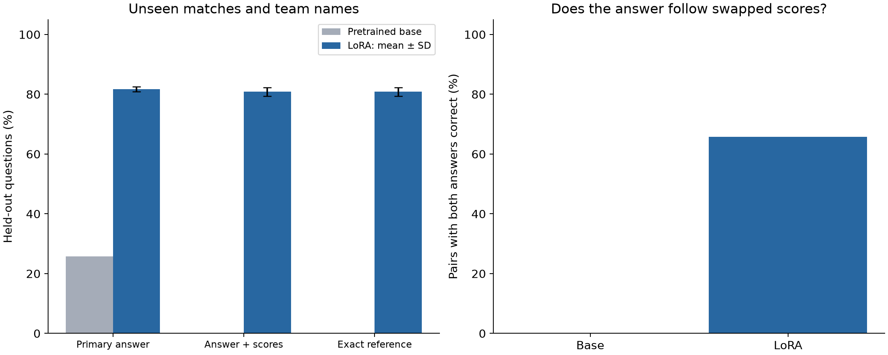
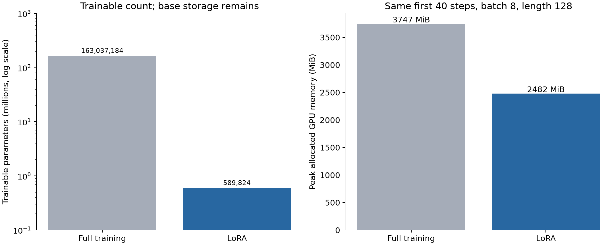
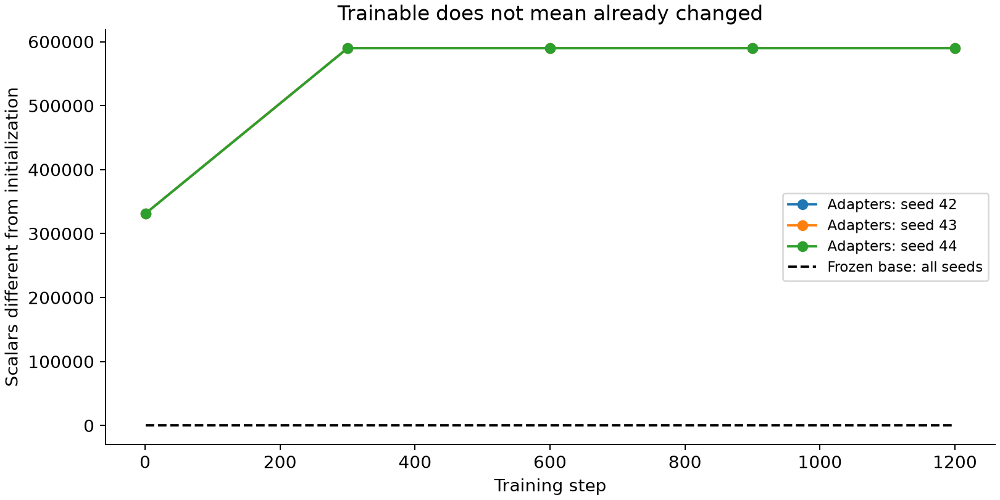

# LoRA unseen-match experiment

Research question: Can LoRA adapt pretrained minGPT/GPT-2 to answer questions about new basketball matches, while leaving the base weights unchanged?

Dataset: original synthetic match scores. Train: 480 matches / 1,440 questions. Validation: 40 matches / 120 questions. Test: 40 matches / 120 questions, plus 120 paired score-swapped questions. Test team names and score quadruples are absent from training. None of the test reference answers occurs in training.

Protocol: FP32, TF32 off, NVIDIA A30, rank 4 / alpha 8, batch 8, padded sequence length 128, AdamW lr 0.001, 1,200 steps per seed. Seeds 42, 43, 44 were fixed before test evaluation. Select checkpoints by validation NLL every 300 steps; evaluate test after selection. Seed 42 is the predeclared live-demo model.

Held-out primary-answer score: base 25.8%; LoRA 81.7% ± 0.8 pp. Correct primary plus score numbers: base 0.0%; LoRA 80.8% ± 1.4 pp. Exact reference match: base 0.0%; LoRA 80.8% ± 1.4 pp. LoRA primary scores by task (means): winner 100.0%, halftime 96.7%, comeback 48.3%.

Both members of counterfactual pairs correct (primary answer): base 0.0%; LoRA 65.8% ± 0.8 pp. A pair counts only when both original and score-swapped answers are correct.

LoRA model: 163,627,008 total scalar parameters; 589,824 trainable (0.3605%); 163,037,184 frozen. Selected seed-42 checkpoint: 589,824 changed scalars; 0 frozen scalars changed. Every audit of every LoRA seed verified the frozen base.

Storage: all LoRA model parameters 624.19 MiB; adapters only 2.25 MiB. Matched first-40-step peak GPU allocated: LoRA 2481.55 MiB, full fine-tuning 3746.96 MiB (33.8% lower). Reserved: 2750.00 vs 4060.00 MiB.

Interpretation: This tests conditional task learning on unseen inputs, not general sports conversation or proof of abstract reasoning. Outputs can reuse learned sentence patterns. Scoring is deliberately transparent but format-sensitive; inspect raw outputs and failures. Three questions share each match; 120 questions are not 120 independent matches. ± denotes sample SD across three training seeds, not a confidence interval. LoRA outputs exactly matching a full training reference, by seed: 1, 0, 0 out of 120 each. Novel wording alone is not proof of correctness.

| Seed | Selected step | Validation NLL | Test NLL | Primary correct | Answer + scores | Exact reference | Both pair members correct |
|---|---:|---:|---:|---:|---:|---:|---:|
| 42 | 1200 | 0.0285 | 0.0407 | 80.8% | 79.2% | 79.2% | 65.0% |
| 43 | 1200 | 0.0260 | 0.0265 | 82.5% | 81.7% | 81.7% | 66.7% |
| 44 | 1200 | 0.0272 | 0.0277 | 81.7% | 81.7% | 81.7% | 65.8% |

| Question type | Base primary correct | LoRA primary correct (mean ± SD) |
|---|---:|---:|
| winner | 57.5% | 100.0% ± 0.0 pp |
| halftime | 20.0% | 96.7% ± 1.4 pp |
| comeback | 0.0% | 48.3% ± 1.4 pp |

